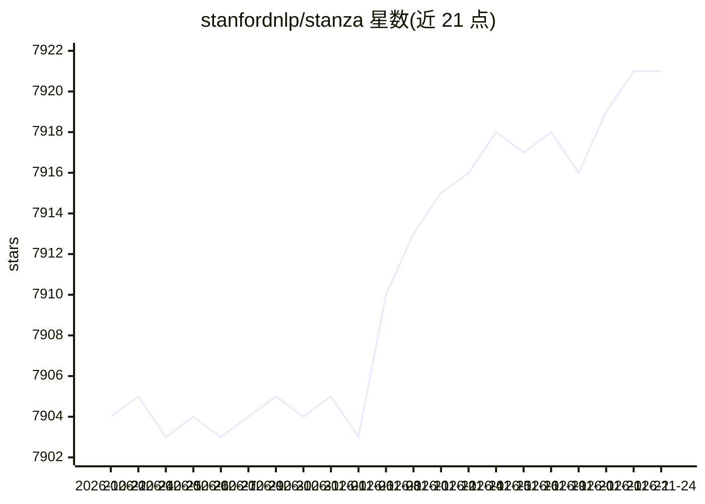

# stanfordnlp/stanza

⭐ 7,921 · Python · NOASSERTION · 推送 2026-11-20 · [GitHub](https://github.com/stanfordnlp/stanza) · [官网](https://stanfordnlp.github.io/stanza/) · 组织维护

**Stanford 官方多语言 NLP 库：分词、句法分析与命名实体识别**

Stanford NLP Group 官方 Python NLP 库，基于 PyTorch 的神经流水线支持 60+ 种语言的分词、句子切分、词性标注、词形还原、依存句法分析与命名实体识别，并内置访问 Java Stanford CoreNLP 的 Python 封装。提供覆盖 Universal Dependencies v2.8 树库的预训练模型及生物医学/临床英文模型包，各神经模块支持用自有数据训练（CoNLL-U/BIOES 格式，需从源码运行训练）。通过 pip、conda 或源码安装，Apache 2.0 许可。

## 筛选速览

| 维度 | 判定 | 备注 |
|---|---|---|
| AI 角色 | `ai-native` | 本体是模型或模型工具 |
| 许可风险 | `none` | NOASSERTION |
| 部署形态 | `library` | 以包/库形式分发 |
| 模型依赖 | — | README 未给出锁定关系 |
| 硬件要求 | — | 无带数字的原话,不猜 |
| 安装摩擦 | `low` | 无编译、无系统依赖或容器化 |
| 成熟度 | — | 结构信号不足 |

## 能力要点

- 支持 60+ 种语言的神经流水线：分词、MWT、POS、词形还原、依存分析、NER
- 内置 Stanford CoreNLP 的官方 Python 封装（CORENLP_HOME 配置）
- 提供 UD v2.8 全树库模型与生物医学/临床英文模型包
- 所有神经模块支持用 CoNLL-U/BIOES 数据自行训练

## 适用场景

- 对多语言文本做分词、句法与依存结构分析
- 从生物医学文献和临床笔记中抽取命名实体
- 用自有标注数据训练定制化的 NLP 流水线

## 场景标签

 · 领域:自然语言处理

## 证据(README 行号)

> L16: The Stanford NLP Group's official Python NLP library. It contains support for running various accurate natural lang
> L104: >>> import stanza
> L106: >>> nlp = stanza.Pipeline('en') # This sets up a default neural pipeline in English

## 星数曲线

2026-10-22 7,904 → 2026-11-24 7,921（+17）

---
*卡片 v1 · prompt 1.4 · 生成 2026-11-22 · 置信度 high · 依据 README sha `c94c7088c0c7` · [字段定义](../../DATASET.md)*
