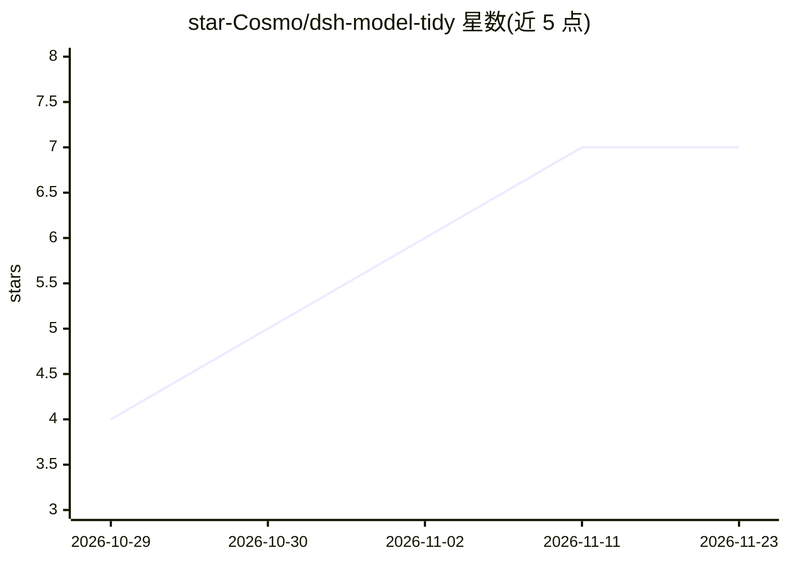

# star-Cosmo/dsh-model-tidy

⭐ 7 · JavaScript · MIT · 推送 2026-10-26 · [GitHub](https://github.com/star-Cosmo/dsh-model-tidy) · 个人维护 · 中文 README

**给 DeepSeek Harness 整理模型列表的插件：隐藏、改名、排序**

面向 DeepSeek Harness 的插件，解决 provider 插件装多后模型选择器条目过多的问题。安装后在 DSH 设置出现「模型整理」分区：每个模型一个显示开关、上下箭头排序、模型与渠道备注名、搜索过滤、渠道级批量隐藏、返回顶部。排序显式保存、跨重启同步；改名时按厂商分隔符保留计费倍率后缀。所有改动仅存于插件自身设置命名空间，不改渠道配置，卸载后列表恢复原样。

## 筛选速览

| 维度 | 判定 | 备注 |
|---|---|---|
| AI 角色 | `ai-ecosystem` | LLM/agent 周边工具 |
| 许可风险 | `permissive` | MIT |
| 部署形态 | `None` |  |
| 模型依赖 | — | README 未给出锁定关系 |
| 硬件要求 | — | 无带数字的原话,不猜 |
| 安装摩擦 | `low` | 无编译、无系统依赖或容器化 |
| 成熟度 | — | 结构信号不足 |

## 能力要点

- 模型级显示开关与排序持久化（重启/换机保留）
- 模型与渠道备注名，保留厂商计费倍率后缀
- 渠道级批量隐藏/显示与全局开关
- 改动只存插件命名空间，卸载即还原

## 适用场景

- 装了多个 provider 插件后精简模型选择器
- 给同一模型的不同渠道分别设置开关与备注
- 把常用渠道和模型排到列表前面并保留倍率标签

## 场景标签

 · 领域:LLM 基础设施/插件工具

## 证据(README 行号)

> L7: 一个让 DeepSeek Harness 的模型选择器保持整洁的插件——决定哪些模型出现、给模型和渠道起你认得的名字、按你觉得顺手的顺序排列，并保住厂商标注的计费倍率。
> L99: 开关作用于**所有**模型来源，不限于手工配置的渠道。插件过滤的是 harness 自己的目录枚举——`ctx.llm.listModels` 与 `ctx.llm.listProviders`，也就是每个界面都会读的那一份列表。
> L106: dsh plugin --profile <你的 profile> add dsh-model-tidy

## 星数曲线

2026-10-29 4 → 2026-11-23 7（+3）

---
*卡片 v1 · prompt 1.4 · 生成 2026-11-20 · 置信度 high · 依据 README sha `b10d7ece4279` · [字段定义](../../DATASET.md)*
