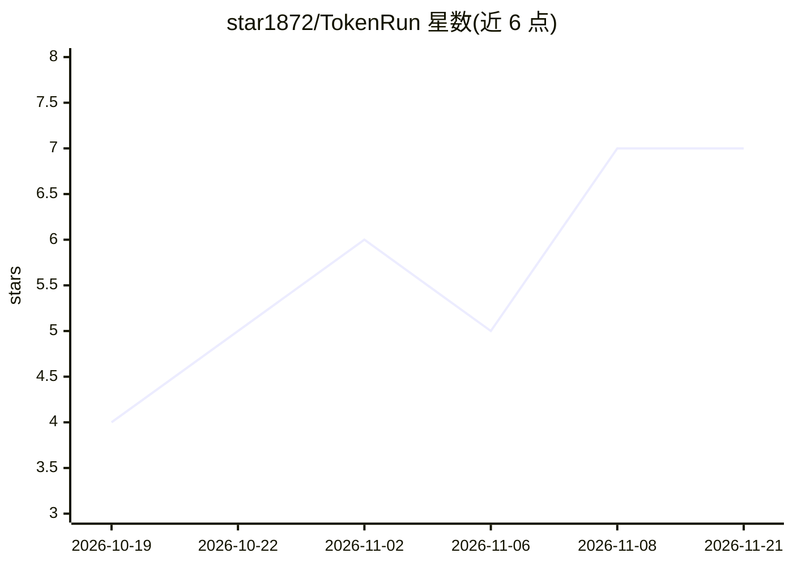

# star1872/TokenRun

⭐ 7 · C++ · MIT · 推送 2026-11-07 · [GitHub](https://github.com/star1872/TokenRun) · [官网](https://www.modelscope.cn/models/mymodel3861/TokenRun) · 个人维护 · 中文 README

**在本地 PC（含旧机型）运行大模型的 Web 应用与推理引擎封装**

基于 Niko1221/Strata 构建的本地模型运行工具：提供 Web 应用，含模型管理器（检测 PC 配置、判断模型是否适配、下载、启停）与聊天页（多会话、系统提示词、重发编辑）。双引擎：Strata 官方引擎运行 Qwen3.8-Flash-Next，llama.cpp 引擎运行任意 GGUF 模型。提供 Windows 解压即用包与 Linux 一键脚本，无需 Python/git；模型与引擎可从 ModelScope 下载并经 SHA-256 校验。Strata 引擎要求 12 GB 以上 VRAM 与 32 GB 以上内存。

## 筛选速览

| 维度 | 判定 | 备注 |
|---|---|---|
| AI 角色 | `ai-ecosystem` | LLM/agent 周边工具 |
| 许可风险 | `permissive` | MIT |
| 部署形态 | `desktop` | 安装包/桌面程序 |
| 模型依赖 | local-ok | 支持本地模型 |
| 硬件要求 | `gpu-24g` | |
| 安装摩擦 | `medium` | 含编译或系统依赖之一 |
| 成熟度 | — | 结构信号不足 |

## 能力要点

- 双引擎：Strata 引擎跑 Qwen3.8-Flash-Next，llama.cpp 引擎跑任意 GGUF 模型
- Web 模型管理器检查 PC 并判断模型是否放得下
- Windows 解压双击、Linux 一条命令安装，无需 Python 或 git
- ModelScope 下载通道（SHA-256 校验）支持中国大陆网络

## 适用场景

- 在无 Python 环境的 Windows/Linux PC 上本地部署聊天模型
- 用旧款 Xeon/DDR3 平台运行超出显存的 MoE 模型
- 通过浏览器管理多模型下载、启动与对话

## 场景标签

`推理引擎` `聊天机器人` · 领域:对话与助手

## 证据(README 行号)

> L6: Web app for chat and model management · Strata and llama.cpp engines · Windows and Linux · free and open source (MIT
> L8: TokenRun is built on Strata by Niko1221. Strata runs
> L16: - **A web app.** Model manager (checks your PC, says which models fit, downloads, starts and stops them) and a chat

## 星数曲线

2026-10-19 4 → 2026-11-21 7（+3）

---
*卡片 v1 · prompt 1.4 · 生成 2026-11-20 · 置信度 high · 依据 README sha `cddc8ecd5f03` · [字段定义](../../DATASET.md)*
