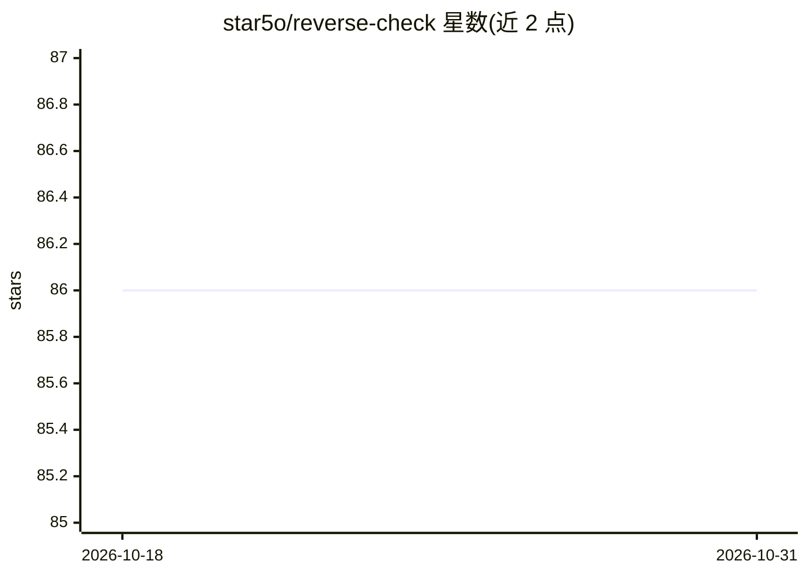

# star5o/reverse-check

⭐ 86 · Vue · MIT · 推送 2026-03-23 · [GitHub](https://github.com/star5o/reverse-check) · [官网](https://reverse-check.no-reverse-api.com) · 个人维护 · 中文 README

**纯前端 LLM API 逆向检测工具：核验 API 是否为官方实现**

基于 Vue 3 的纯前端工具，用于检测 LLM API 是否支持官方参数，据此判断 API 是否为逆向实现。支持 OpenAI、Claude、Gemini 三家提供商的检测，覆盖 max_tokens、logprobs、n、stop、function_call、response_format、图像输入等参数项，并针对推理模型提供 reasoning_max_tokens/reasoning_stop 检测。用户填写 API Base URL、Key 与模型名称后发起检测，页面实时展示请求信息、响应结果与官方示例对比。当前版本需人工对比结果判断，自动化检测在待办中；支持 Vercel 一键部署或 npm 本地运行。

## 筛选速览

| 维度 | 判定 | 备注 |
|---|---|---|
| AI 角色 | `ai-ecosystem` | LLM/agent 周边工具 |
| 许可风险 | `permissive` | MIT |
| 部署形态 | `library` | 以包/库形式分发 |
| 模型依赖 | locked-api |  |
| 硬件要求 | — | 无带数字的原话,不猜 |
| 安装摩擦 | `low` | 无编译、无系统依赖或容器化 |
| 成熟度 | `idea` | |

## 能力要点

- 检测 OpenAI/Claude/Gemini 三家提供商的 API 参数支持情况
- 覆盖 max_tokens、logprobs、n、stop、function_call、response_format 等参数项
- 推理模型专用检测参数（reasoning_max_tokens/reasoning_stop）
- 纯前端实现，支持 Vercel 一键部署

## 适用场景

- 核验第三方转售的 API Key 是否为官方接口
- 对比逆向 API 与官方 API 的参数行为差异
- 部署到 Vercel 后随时对自用 API 做检测

## 场景标签

 · 领域:LLM 基础设施/API 测试

## 证据(README 行号)

> L10: 本工具是一个基于是否支持官方参数的逆向检测工具。不能通过本工具检测的API极大概率是逆向的。
> L16: - 🔍 支持多种模型提供商的API检测

## 星数曲线

2026-10-18 86 → 2026-10-31 86（+0）

---
*卡片 v1 · prompt 1.4 · 生成 2026-10-24 · 置信度 high · 依据 README sha `3cf1ffa37e6e` · [字段定义](../../DATASET.md)*
