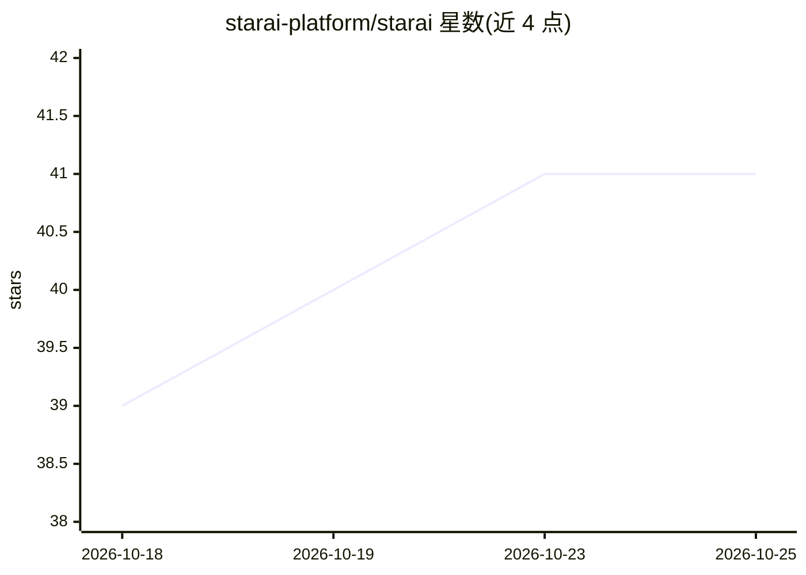

# starai-platform/starai

⭐ 41 · TypeScript · MIT · 推送 2026-10-09 · [GitHub](https://github.com/starai-platform/starai) · [官网](https://star-ai.life) · 组织维护 · 中文 README

**开源 AI 聚合平台：对话、多媒体生成、智能体与计费一体化建站**

面向搭建 AI 工具站、模型聚合平台或企业内部 AI 助手的开源平台（当前 0.6.0）：聚合对话、推理、图片、视频、音频模型能力，提供前台工作台、灵感广场、智能体工作流、OpenAI 兼容开放 API，以及钱包余额、卡密充值与按次/按秒/按 Token/按图的计费和管理后台。20 个 New API/OpenLux 兼容接口模板覆盖 Grok、Doubao、Qwen、Wan、Vidu、MiniMax 等系列。技术栈为 Next.js + Go/Gin + PostgreSQL + Redis，支持 Docker Compose 一键部署与可选内置 SearXNG 自建搜索。MIT 许可。

## 筛选速览

| 维度 | 判定 | 备注 |
|---|---|---|
| AI 角色 | `ai-ecosystem` | LLM/agent 周边工具 |
| 许可风险 | `permissive` | MIT |
| 部署形态 | `self-host` | docker 或自建部署 |
| 模型依赖 | — | README 未给出锁定关系 |
| 硬件要求 | — | 无带数字的原话,不猜 |
| 安装摩擦 | `low` | 无编译、无系统依赖或容器化 |
| 成熟度 | — | 结构信号不足 |

## 能力要点

- 统一聚合对话、推理、图片、视频、音频与智能体工作流
- 提供 OpenAI 兼容开放 API 与 20 个多媒体接口模板
- 钱包计费体系：按次/按秒/按 Token/按图计费，含冻结、结算与失败释放
- Docker Compose 一键部署，附带本地 Mock 网关与默认开发账号

## 适用场景

- 搭建自己的 AI 工具站或创作平台对外提供服务
- 企业内部部署统一的 AI 助手与模型聚合入口
- 通过 OpenAI 兼容 API 为下游系统提供模型能力
- 运营带钱包充值与计费的多媒体生成站点

## 场景标签

`模型网关` `图像生成` `视频生成` `语音合成` · 领域:Agent 开发

## 证据(README 行号)

> L3: StarAI 是一套开源 AI 聚合平台，可把对话、推理、图片、视频、音频、智能体工作流和 OpenAI 兼容 API 聚合到同一个站点中。你可以用它搭建 AI 工具站、AI 创作平台、模型聚合平台或企业内部 AI 助手。
> L15: - 开放 API：提供 OpenAI 兼容接口，便于下游系统调用。
> L44: |部署|Docker Compose|

## 星数曲线

2026-10-18 39 → 2026-10-25 41（+2）

---
*卡片 v1 · prompt 1.4 · 生成 2026-10-25 · 置信度 mid · 依据 README sha `ad58de92fd99` · [字段定义](../../DATASET.md)*
