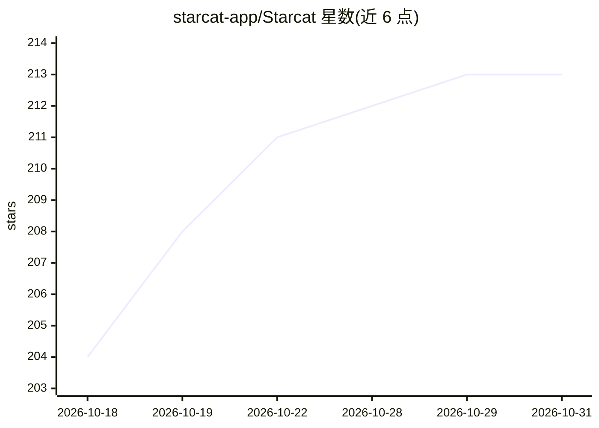

# starcat-app/Starcat

⭐ 213 · Swift · MIT · 推送 2026-10-30 · [GitHub](https://github.com/starcat-app/Starcat) · [官网](https://starcat.ink) · 组织维护 · 中文 README

**macOS 原生 GitHub Stars 管理器与本地 RAG 知识库**

面向 GitHub Stars 积累过多用户的原生 macOS 应用：OAuth 登录后增量同步收藏仓库到本地 SQLite，提供标签、私有笔记、阅读状态、FTS5 与语义搜索、README 渲染、GitHub 通知收件箱与仓库健康评估。被摄取的仓库进入知识库，RAG 工作区以 FTS5+嵌入+RRF 混合检索，回答带可回溯到段落的引用。AI 功能（摘要、笔记草稿、repo chat）通过 BYOK 或自托管代理接入 Gemini/OpenAI/Claude/DeepSeek/Ollama。核心组织功能免费，Pro 工作流与更高 AI 配额走 App Store 内购或 Direct 许可；源码自建无需许可。限 macOS 15+。

## 筛选速览

| 维度 | 判定 | 备注 |
|---|---|---|
| AI 角色 | `ai-enhanced` | 去掉 AI 部分产品仍成立 |
| 许可风险 | `permissive` | MIT |
| 部署形态 | `desktop` | 安装包/桌面程序 |
| 模型依赖 | local-ok | 支持本地模型 |
| 硬件要求 | — | 无带数字的原话,不猜 |
| 安装摩擦 | `medium` | 含编译或系统依赖之一 |
| 成熟度 | — | 结构信号不足 |

## 能力要点

- 本地优先：数据存本地 SQLite，AI 密钥存 Keychain，Ollama 可全程本机
- RAG 工作区混合检索（FTS5+嵌入+RRF），引用可定位到证据段落
- 内嵌 codebase-memory-mcp 符号级代码图与 codeflow 架构检查
- CLI、MCP、Agent Skill、浏览器插件与 Alfred/Raycast/uTools 扩展读取同一本地数据

## 适用场景

- 把大量 GitHub Stars 整理成可搜索、可提问的私有知识库
- 追踪收藏仓库的更新、健康度与安全评分
- 在仓库上下文中直接提问、生成摘要与标签建议
- 在 GitHub 页面上通过浏览器插件查看自己的笔记与健康信息

## 场景标签

`知识库管理` `语义搜索` `文档问答` · 领域:知识与检索

## 证据(README 行号)

> L30: **Starcat** is a native macOS app for people whose GitHub Stars have outgrown a bookmark list. It syncs starred rep
> L150: This is AI in the main-window detail pane, not a separate workspace. Notes, summaries, and tags stay on this Mac. 

## 星数曲线

2026-10-18 204 → 2026-10-31 213（+9）

---
*卡片 v1 · prompt 1.4 · 生成 2026-10-22 · 置信度 high · 依据 README sha `da235bfc3c6d` · [字段定义](../../DATASET.md)*
