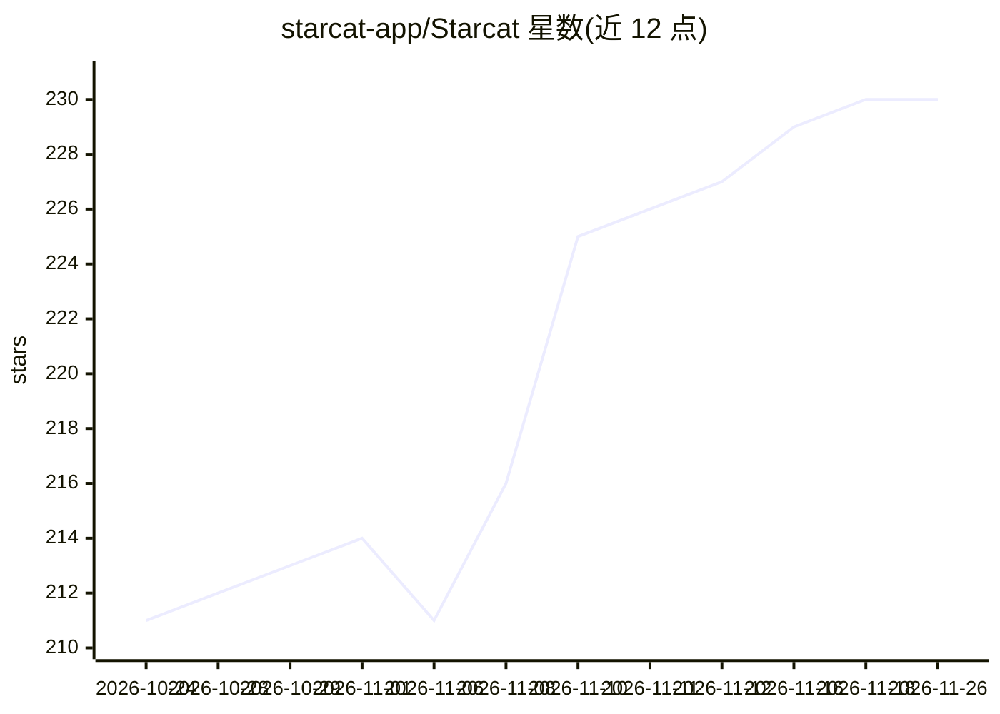

# starcat-app/Starcat

⭐ 230 · Swift · MIT · 推送 2026-11-23 · [GitHub](https://github.com/starcat-app/Starcat) · [官网](https://starcat.ink) · 个人维护 · 中文 README

**macOS 原生 GitHub Stars 管理器与本地 RAG 知识库**

面向 Stars 数量超出一般书签用途的 GitHub 用户：通过 OAuth 同步 starred 仓库到本地 SQLite，提供标签、笔记、阅读状态、FTS5 与语义搜索、Release 跟踪、仓库健康评估（Repo Health、OpenSSF Scorecard）。AI 部分包括基于 FTS5+embeddings+RRF 的知识库 RAG 问答（带 chunk 级引用）、README 摘要与标签生成、repo chat。AI 采用 BYOK 或自托管代理，支持 Gemini、OpenAI、Claude、DeepSeek、Ollama。安装方式为 Homebrew 或 DMG，另有 Mac App Store 版本，核心功能免费，Pro 工作流与更高 AI 配额为付费。

## 筛选速览

| 维度 | 判定 | 备注 |
|---|---|---|
| AI 角色 | `ai-native` | 本体是模型或模型工具 |
| 许可风险 | `permissive` | MIT |
| 部署形态 | `desktop` | 安装包/桌面程序 |
| 模型依赖 | local-ok | 支持本地模型 |
| 硬件要求 | — | 无带数字的原话,不猜 |
| 安装摩擦 | `medium` | 含编译或系统依赖之一 |
| 成熟度 | — | 结构信号不足 |

## 能力要点

- 本地 RAG 问答：FTS5 关键词+embeddings+RRF 混合检索，chunk 级引用可回溯到段落
- BYOK 或自托管代理接入 Gemini/OpenAI/Claude/DeepSeek/Ollama
- 嵌入 codebase-memory-mcp（符号级知识图谱 3D 视图）与 codeflow（架构检查）两个分析器
- CLI、MCP、浏览器插件与 Alfred/uTools/Raycast 读取本地数据

## 适用场景

- 把 GitHub Stars 整理成可搜索、可提问的个人知识库
- 对已入库仓库直接提问构建方式与功能位置
- 批量生成仓库摘要与标签后逐一确认
- 自托管分享页向未安装用户分享 starred 仓库

## 场景标签

`知识库管理` `RAG` `语义搜索` · 领域:知识与检索

## 证据(README 行号)

> L30: **Starcat** is a native macOS app for people whose GitHub Stars have outgrown a bookmark list. It syncs starred rep
> L107: The layout is a conversation rail, an answer surface, and a Citation Inspector. Retrieval mixes FTS5 keywords, emb
> L160: AI runs through BYOK or a self-hosted proxy: Gemini, OpenAI, Anthropic Claude, DeepSeek, Ollama. Keys and quotas s

## 星数曲线

2026-10-24 211 → 2026-11-26 230（+19）

---
*卡片 v1 · prompt 1.4 · 生成 2026-11-26 · 置信度 high · 依据 README sha `0ea0900e256b` · [字段定义](../../DATASET.md)*
