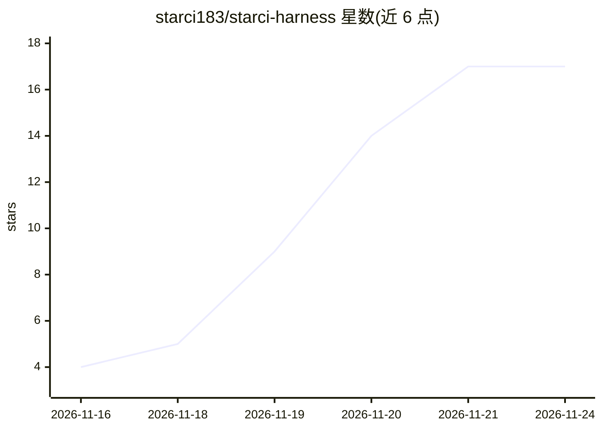

# starci183/starci-harness

⭐ 17 · TypeScript · MIT · 推送 2026-11-24 · [GitHub](https://github.com/starci183/starci-harness) · 个人维护 · 中文 README

**给 AI 编码代理的任务加契约与干净校验的 CLI 工具**

starci 是一个命令行工具，为 AI 代理的每项工作写入任务契约（可写的路径、输入、输出、机器可执行的检查清单与预算），代理完成工作后在干净 checkout 上重放检查，通过才合入分支。工作流以任务图组织，经 orca runner 分派到工作者席位或 inline 模式交给当前对话代理；所有任务与工作流记录在仓库外的 SQLite 台账中，会话关闭后仍可恢复。通过 npm 安装（alpha 标签），也可下载 Windows/macOS 桌面应用；部分动词（host daemon、shell 补全等）尚未实现。

## 筛选速览

| 维度 | 判定 | 备注 |
|---|---|---|
| AI 角色 | `ai-ecosystem` | LLM/agent 周边工具 |
| 许可风险 | `permissive` | MIT |
| 部署形态 | `desktop` | 安装包/桌面程序 |
| 模型依赖 | — | README 未给出锁定关系 |
| 硬件要求 | — | 无带数字的原话,不猜 |
| 安装摩擦 | `low` | 无编译、无系统依赖或容器化 |
| 成熟度 | `idea` | |

## 能力要点

- 任务契约机制：上下文、输入、输出键、机器检查与分钟/重试预算
- 干净 checkout 上重放检查，绿色才落分支，代理不做自我评判
- 工作流为任务图，支持 amend 增量重做受影响任务
- SQLite 台账存于仓库外，运行状态可跨会话存续

## 适用场景

- 给 AI 代理写的代码建立强制质量门与自动验证流程
- 把多个代理任务编排为带依赖的工作流并行推进
- 跨多个代理席位统一路由模型与预算管理

## 场景标签

`编码 Agent` · 领域:编码与开发

## 证据(README 行号)

> L12: AI agents write code fast and check it badly. The StarCi harness gives every piece of agent work a contract of
> L97: worker seats launched through Orca, routed to an agent and model by ops/routing.yaml; under the

## 星数曲线

2026-11-16 4 → 2026-11-24 17（+13）

---
*卡片 v1 · prompt 1.4 · 生成 2026-11-20 · 置信度 mid · 依据 README sha `c87d6c0f07b0` · [字段定义](../../DATASET.md)*
