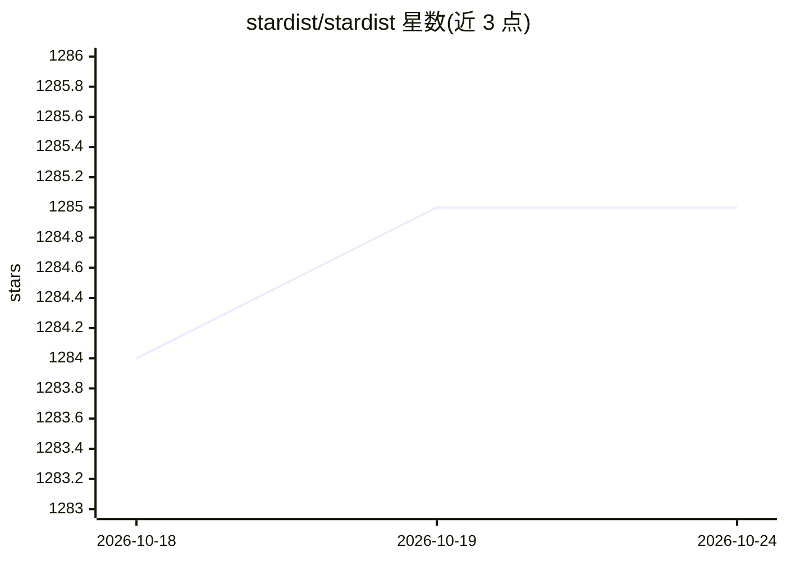

# stardist/stardist

⭐ 1,285 · Python · BSD-3-Clause · 推送 2026-02-14 · [GitHub](https://github.com/stardist/stardist) · 组织维护

**显微镜图像中细胞核的星凸形状实例分割库（2D/3D）**

基于星凸多边形/多面体的目标检测与实例分割 Python 实现，面向 2D 图像与 3D 体积数据。模型沿固定射线预测到物体边界的距离与物体概率，经 NMS 得到实例结果；支持多类别预测与预训练模型（荧光与 H&E 染色细胞核）。依赖 TensorFlow 1/2，pip 安装提供预编译 wheels；另含实例分割指标计算子模块与标注工具指南（Labkit/QuPath）。作者请求引用 MICCAI 2018 等论文。

## 筛选速览

| 维度 | 判定 | 备注 |
|---|---|---|
| AI 角色 | `ai-native` | 本体是模型或模型工具 |
| 许可风险 | `permissive` | BSD-3-Clause |
| 部署形态 | `library` | 以包/库形式分发 |
| 模型依赖 | — | README 未给出锁定关系 |
| 硬件要求 | — | 无带数字的原话,不猜 |
| 安装摩擦 | `high` | 编译与系统依赖俱全 |
| 成熟度 | — | 结构信号不足 |

## 能力要点

- 星凸形状模型在 2D/3D 图像上做细胞实例分割
- 提供荧光与 H&E 染色的 2D 预训练模型
- 支持多类别预测（如细胞类型分类）
- stardist.matching 子模块计算 precision/recall/f1/panoptic_quality 等指标

## 适用场景

- 显微镜图像中细胞核的自动实例分割
- 组织病理学 H&E 图像的细胞核检测与分类
- 评估分割预测与标注掩码的匹配指标

## 场景标签

`目标检测` · 领域:感知与多模态

## 证据(README 行号)

> L10: This repository contains the Python implementation of star-convex object detection for 2D and 3D images, as describ
> L29: A model is trained to densely predict the distances (r) to the object boundary along a fixed set of rays and object

## 星数曲线

2026-10-18 1,284 → 2026-10-24 1,285（+1）

---
*卡片 v1 · prompt 1.4 · 生成 2026-10-21 · 置信度 high · 依据 README sha `8d90c81edde0` · [字段定义](../../DATASET.md)*
