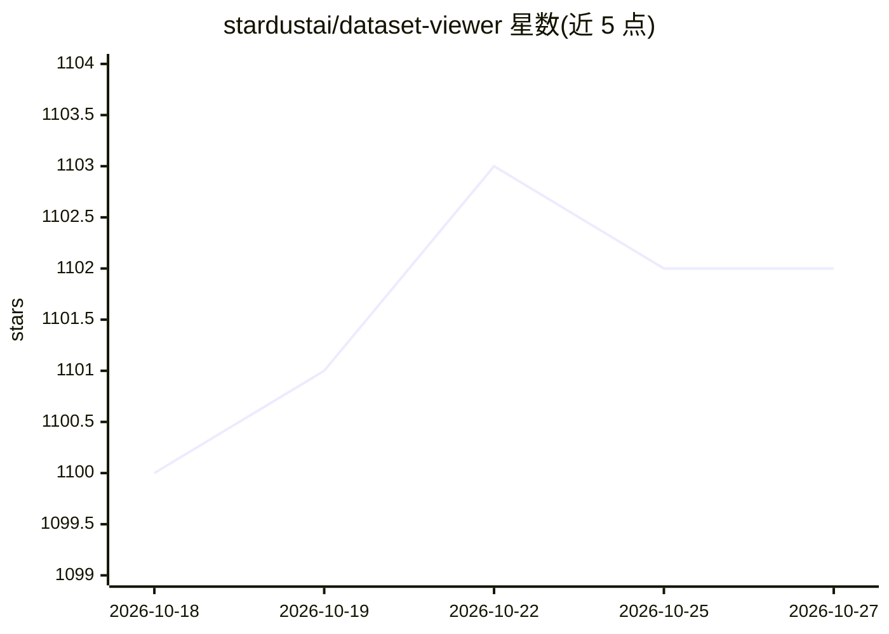

# stardustai/dataset-viewer

⭐ 1,102 · TypeScript · 推送 2026-03-28 · [GitHub](https://github.com/stardustai/dataset-viewer) · [官网](https://stardustai.github.io/dataset-viewer) · 个人维护 · 中文 README

**跨协议大数据集桌面查看器：流式打开 100GB+ 文件与归档**

基于 Tauri(Rust)+React+TypeScript 的桌面数据集查看器：以流式分块加载与虚拟滚动打开 100GB+ 大文件，支持 WebDAV、SSH/SFTP、SMB/CIFS、S3、本地与 HuggingFace Hub 多协议源；可预览 Parquet/Excel/CSV/JSON、代码、文档、媒体与 ZIP/TAR 归档（免解压），提供毫秒级搜索与 3D 点云查看。README 声明代码库 100% 由 AI 辅助生成，但应用功能本身不含 AI 能力。面向数据科学家与日志分析场景，通过 GitHub Release 分发，并带插件 SDK 供扩展格式支持。

## 筛选速览

| 维度 | 判定 | 备注 |
|---|---|---|
| AI 角色 | `ai-enhanced` | 去掉 AI 部分产品仍成立 |
| 许可风险 | `permissive` | — |
| 部署形态 | `None` |  |
| 模型依赖 | — | README 未给出锁定关系 |
| 硬件要求 | — | 无带数字的原话,不猜 |
| 安装摩擦 | `low` | 无编译、无系统依赖或容器化 |
| 成熟度 | — | 结构信号不足 |

## 能力要点

- 流式分块加载与虚拟滚动支持 100GB+ 大文件
- WebDAV/SSH/SMB/S3/本地/HuggingFace Hub 六类数据源
- ZIP/TAR 归档免解压直接预览
- @dataset-viewer/sdk 插件开发体系

## 适用场景

- 直接浏览远端或本地的大体量 Parquet/CSV 数据集
- 在不解压的情况下查看 ZIP/TAR 归档内容
- 在大日志文件中做毫秒级搜索定位

## 场景标签

 · 领域:数据工具/桌面应用

## 证据(README 行号)

> L7: A modern, high-performance dataset viewer built with Tauri, React, and TypeScript. Designed to handle massive datase
> L56: - 🤖 **100% AI-Generated**: Entire codebase created through AI assistance

## 星数曲线

2026-10-18 1,100 → 2026-10-27 1,102（+2）

---
*卡片 v1 · prompt 1.4 · 生成 2026-10-21 · 置信度 mid · 依据 README sha `b3144b0b75a6` · [字段定义](../../DATASET.md)*
