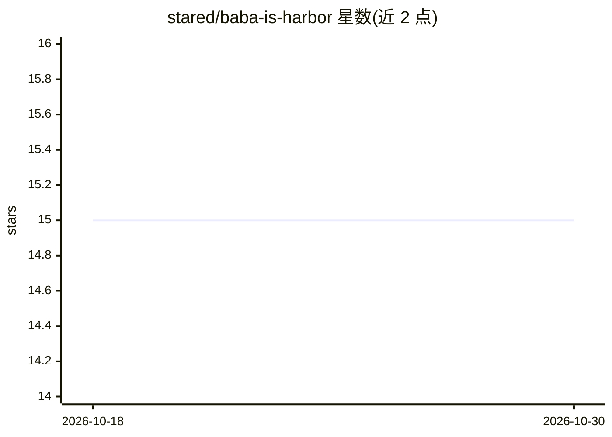

# stared/baba-is-harbor

⭐ 15 · Python · Apache-2.0 · 推送 2026-09-11 · [GitHub](https://github.com/stared/baba-is-harbor) · [官网](https://quesma.com/benchmarks/babaisbench/) · 个人维护

**基于 Baba Is You 的 AI agent 解谜基准（Harbor 框架）**

在 Harbor 框架上以 Baba Is You 为载体的 agent 评测基准：agent 接收 JSON 网格谜题与交互式模拟器 CLI（baba/babasim），需输出获胜移动串；验证器通过真实游戏引擎回放，当 you 对象到达 win 对象时奖励为 1。仓库不含游戏资产，需本地拥有游戏并通过脚本提取关卡（55 关，stages 0-3）。引擎以权限分离方式运行，agent 可执行但不可读取引擎；提供提示变体与更长时限变体，并对 522 次获胜运行做了记忆化审计。运行依赖 uv、Docker、Harbor 工具。

## 筛选速览

| 维度 | 判定 | 备注 |
|---|---|---|
| AI 角色 | `ai-ecosystem` | LLM/agent 周边工具 |
| 许可风险 | `permissive` | Apache-2.0 |
| 部署形态 | `None` |  |
| 模型依赖 | — | README 未给出锁定关系 |
| 硬件要求 | — | 无带数字的原话,不猜 |
| 安装摩擦 | `low` | 无编译、无系统依赖或容器化 |
| 成熟度 | — | 结构信号不足 |

## 能力要点

- 真实游戏引擎回放验证，获胜即 you 到达 win
- 55 个关卡任务，带已验证的 oracle 解（solution/solve.sh）
- 引擎权限分离：agent 仅能通过 sudo-gated runner 运行模拟器
- 提供提示变体（tasks_hint）与 120 分钟时限变体，及 522 次获胜运行的记忆化审计

## 适用场景

- 评测 LLM/agent 在规则组合解谜上的规划与搜索能力
- 对比带提示与无提示条件下记忆化与真实搜索的差异
- 用 12 模型扫描脚本批量跑基准并复现发布数字

## 场景标签

`模型评测` · 领域:评测与运维

## 证据(README 行号)

> L3: Baba Is You as an agent benchmark, on the
> L6: The verifier replays those moves through the **real game engine** — reward 1 iff

## 星数曲线

2026-10-18 15 → 2026-10-30 15（+0）

---
*卡片 v1 · prompt 1.4 · 生成 2026-10-30 · 置信度 high · 依据 README sha `7c4fd58379ea` · [字段定义](../../DATASET.md)*
