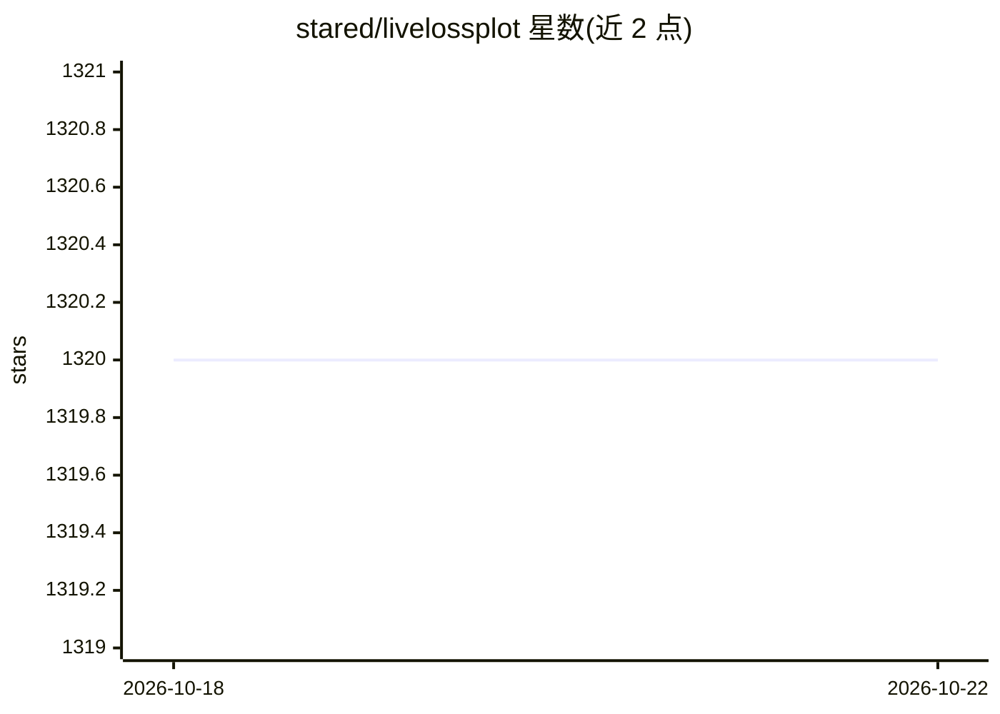

# stared/livelossplot

⭐ 1,320 · Python · MIT · 推送 2026-07-26 · [GitHub](https://github.com/stared/livelossplot) · 个人维护

**Jupyter Notebook 中实时绘制深度学习训练损失曲线的 Python 包**

面向在 Jupyter Notebook 中训练 Keras、PyTorch 等模型的开发者，在每个 epoch 实时绘制损失与指标曲线。提供通用 PlotLosses API 及 Keras、Poutyne、Ignite 等框架回调，输出支持 Matplotlib、Bokeh 与 TensorBoard logger；也可仅用 ExtremaPrinter 输出到标准输出。以 Python 包形式在 PyPI 发布，要求 Python 3.10+，可用 pip/uv 安装或 uv run 临时运行。

## 筛选速览

| 维度 | 判定 | 备注 |
|---|---|---|
| AI 角色 | `ai-ecosystem` | LLM/agent 周边工具 |
| 许可风险 | `permissive` | MIT |
| 部署形态 | `library` | 以包/库形式分发 |
| 模型依赖 | — | README 未给出锁定关系 |
| 硬件要求 | — | 无带数字的原话,不猜 |
| 安装摩擦 | `low` | 无编译、无系统依赖或容器化 |
| 成熟度 | — | 结构信号不足 |

## 能力要点

- Keras/PyTorch/Poutyne/Ignite 等框架的内置回调适配
- 每个 epoch 实时更新训练损失与指标图
- 输出后端可选 Matplotlib、Bokeh、TensorBoard logger

## 适用场景

- 在 Jupyter Notebook 训练小模型时实时观察是否在学习或过拟合
- 教学与探索场景下无需 TensorBoard 即可可视化训练过程
- 为自用训练脚本接入通用日志绘图 API

## 场景标签

 · 领域:机器学习工具/可视化

## 证据(README 行号)

> L17: A live training loss plot in Jupyter Notebook for Keras, PyTorch and other frameworks. An open-source Python packag
> L111: There are callbacks for common libraries and frameworks: `PlotLossesKeras`, `PlotLossesKerasTF`, `PlotLossesPoutyn

## 星数曲线

2026-10-18 1,320 → 2026-10-22 1,320（+0）

---
*卡片 v1 · prompt 1.4 · 生成 2026-10-21 · 置信度 high · 依据 README sha `6dfa0194c9e1` · [字段定义](../../DATASET.md)*
