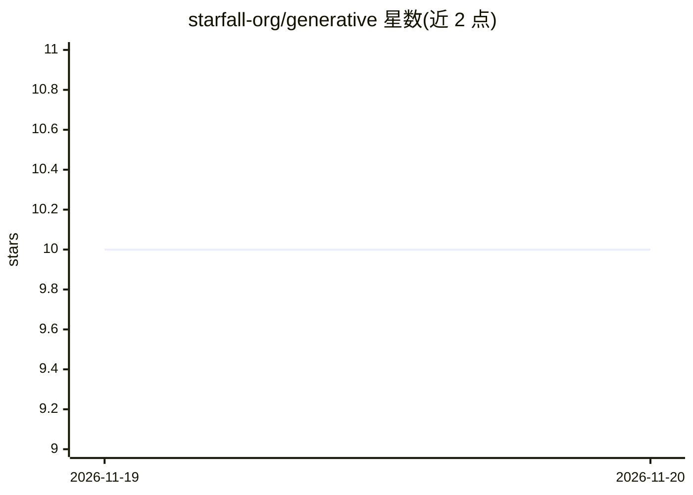

# starfall-org/generative

⭐ 10 · Kotlin · NOASSERTION · 推送 2026-11-19 · [GitHub](https://github.com/starfall-org/generative) · [官网](https://starfall-org.github.io/generative/) · 组织维护

**Android 原生 AI 客户端：BYOK 接入多家模型服务**

一款 Kotlin 编写的 Android 原生 AI 聊天客户端，用户自带 API key 或账号登录后接入 OpenAI 兼容 API、Anthropic、Gemini、Ollama 等服务。支持流式推理展示、消息版本切换、Markdown/LaTeX 渲染、远程 MCP 服务器连接与工具权限管理，还提供 SSH 工作区（远程终端、SFTP、端口转发）、图像/视频/音乐生成的多步请求模板、可导入 GitHub 技能的 prompt 管理以及本地存储与加密。对话本地存储，可 ZIP 导出备份，OAuth 凭证用 Android Keystore 加密。提供 APK 下载，也可从源码构建（需 JDK 17 与 Android SDK）。

## 筛选速览

| 维度 | 判定 | 备注 |
|---|---|---|
| AI 角色 | `ai-native` | 本体是模型或模型工具 |
| 许可风险 | `none` | NOASSERTION |
| 部署形态 | `None` |  |
| 模型依赖 | local-ok | 支持本地模型 |
| 硬件要求 | — | 无带数字的原话,不猜 |
| 安装摩擦 | `medium` | 含编译或系统依赖之一 |
| 成熟度 | — | 结构信号不足 |

## 能力要点

- BYOK 接入 OpenAI 兼容 API、Anthropic、Gemini、Ollama 及账号登录（Codex、Claude Code、Copilot 等）
- 连接远程 MCP 服务器（Streamable HTTP/SSE）并管理工具访问权限
- SSH 工作区：远程终端、端口转发、SFTP 与跳板机连接
- 本地存储对话、ZIP 备份导入导出与 Keystore 凭证加密

## 适用场景

- 在 Android 手机上用自备 API key 聊天并切换多家模型服务
- 通过 MCP 连接外部工具和网页搜索服务
- 从手机 SSH 管理远程机器并配合 AI 使用

## 场景标签

`AI 助手` · 领域:对话与助手

## 证据(README 行号)

> L28: Generative is a native Android AI client for your own models, tools, and remote machines. Bring your own API key or
> L32: - **Models on your terms:** Connect OpenAI-compatible APIs, OpenAI Responses, Anthropic, Gemini, Ollama, or support
> L34: - **MCP tools with control:** Connect remote MCP servers over Streamable HTTP or SSE, manage tool access, and choos

## 星数曲线

2026-11-19 10 → 2026-11-20 10（+0）

---
*卡片 v1 · prompt 1.4 · 生成 2026-11-19 · 置信度 high · 依据 README sha `0d0877a10524` · [字段定义](../../DATASET.md)*
