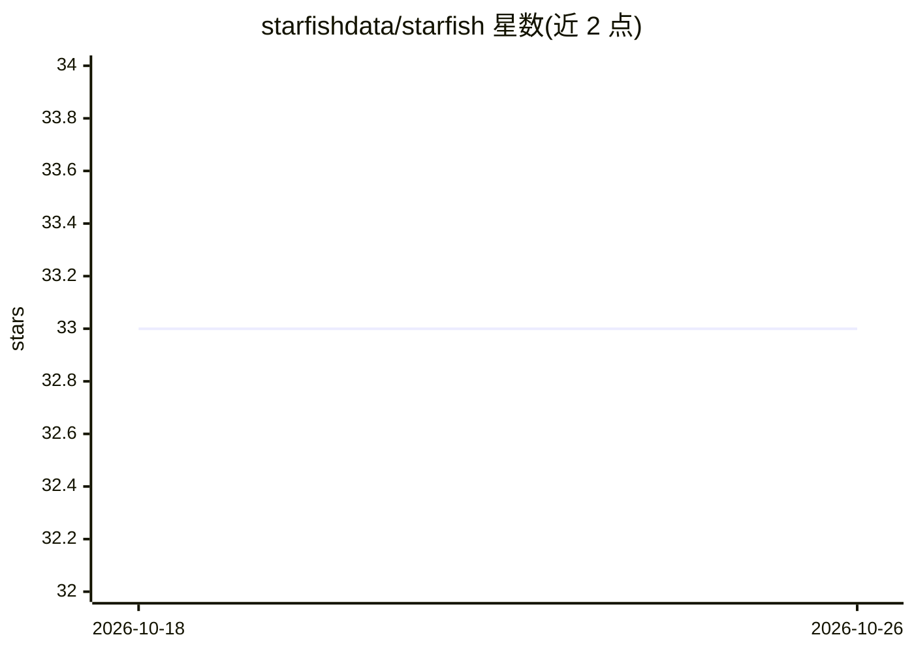

# starfishdata/starfish

⭐ 33 · Python · Apache-2.0 · 推送 2026-03-11 · [GitHub](https://github.com/starfishdata/starfish) · [官网](https://www.starfishdata.ai) · 组织维护

**Python 合成数据生成库：用 LLM 大规模产出结构化数据**

供开发者构建合成数据管线的 Python 库：通过 JSON schema 或 Pydantic 模型定义结构化输出，经 LiteLLM 接入任意 LLM 提供商（含本地模型、OpenAI、Anthropic）；data_factory 装饰器将任意函数转为并行数据管线，支持 Jinja2 动态提示词、自动重试、任务暂停续跑与自定义钩子。以 pip 安装 starfish-core，经 .env 环境变量配置 API key 与模型参数，可选安装 pdf/docx 等文件解析依赖。组织同时提供托管服务（starfishdata.ai）。

## 筛选速览

| 维度 | 判定 | 备注 |
|---|---|---|
| AI 角色 | `ai-ecosystem` | LLM/agent 周边工具 |
| 许可风险 | `permissive` | Apache-2.0 |
| 部署形态 | `library` | 以包/库形式分发 |
| 模型依赖 | — | README 未给出锁定关系 |
| 硬件要求 | — | 无带数字的原话,不猜 |
| 安装摩擦 | `low` | 无编译、无系统依赖或容器化 |
| 成熟度 | — | 结构信号不足 |

## 能力要点

- JSON schema/Pydantic 定义的结构化 LLM 输出
- data_factory 装饰器将函数转为跨数千输入的并行管线
- 经 LiteLLM 接入任意 LLM 提供商（含本地模型）
- 自动重试、任务暂停续跑与自定义钩子扩展

## 适用场景

- 用 LLM 按定义的 schema 批量生成训练/微调用合成数据
- 把现有数据处理函数扩展成可并行的大规模生成管线
- 实验到生产场景下可持续中断续跑的数据生成任务

## 场景标签

 · 领域:AI 数据工程/合成数据生成

## 证据(README 行号)

> L14: Starfish is a Python library that helps you build synthetic data your way. We adapt to your workflow—not the other 
> L20: - **Model Flexibility**: Use any LLM provider—local models, OpenAI, Anthropic, or your own implementation via LiteL
> L22: - **Easy Scaling**: Transform any function to run in parallel across thousands of inputs with a single decorator.

## 星数曲线

2026-10-18 33 → 2026-10-26 33（+0）

---
*卡片 v1 · prompt 1.4 · 生成 2026-10-25 · 置信度 high · 依据 README sha `950183dca459` · [字段定义](../../DATASET.md)*
