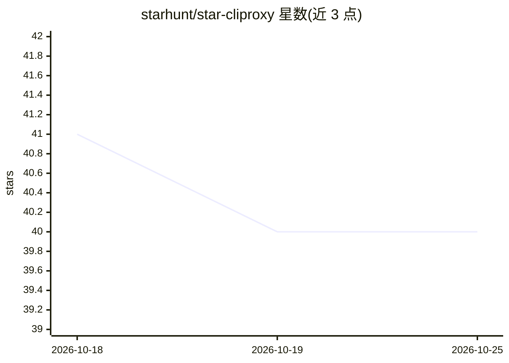

# starhunt/star-cliproxy

⭐ 42 · TypeScript · 推送 2026-08-12 · [GitHub](https://github.com/starhunt/star-cliproxy) · 组织维护 · 中文 README

**把已订阅的 AI 编程 CLI 封装成本地 OpenAI/Anthropic 兼容 API 的代理网关**

面向已持有 Claude Max、ChatGPT Pro 等订阅的开发者：将本地安装的 6 种 AI 编程 CLI（Claude Code、Codex、Copilot、Antigravity、Grok、Kimi）以子进程方式运行，统一暴露为本地 OpenAI 兼容端点（/v1/chat/completions、/v1/messages 等）及 Anthropic Messages API，按订阅计费而非按 token。支持任意 OpenAI 兼容 HTTP 服务器（vLLM、Ollama 等）与自定义插件作后端，提供别名模型映射、优先级回退、四种执行模式、原生 SSE 流式输出与带 Playground 的 Web 仪表盘。限制：需 Node.js 20+ 与至少一个完成登录的 CLI；订阅使用仍受各提供商服务条款约束。

## 筛选速览

| 维度 | 判定 | 备注 |
|---|---|---|
| AI 角色 | `ai-ecosystem` | LLM/agent 周边工具 |
| 许可风险 | `none` | — |
| 部署形态 | `library` | 以包/库形式分发 |
| 模型依赖 | local-ok | 支持本地模型 |
| 硬件要求 | — | 无带数字的原话,不猜 |
| 安装摩擦 | `low` | 无编译、无系统依赖或容器化 |
| 成熟度 | — | 结构信号不足 |

## 能力要点

- 6 种内置 CLI 后端 + OpenAI 兼容 HTTP 服务器 + 自定义插件
- 同时提供 OpenAI 兼容与 Anthropic Messages API 端点
- 别名模型映射、优先级回退链与 4 种执行模式（cli/sdk/app-server/channel-worker）
- 带 Playground、请求追踪与密钥管理的 Web 仪表盘

## 适用场景

- 用已有的 Claude Max / ChatGPT Pro 订阅替代按 token 计费的 API 调用
- 让现有 OpenAI SDK 代码仅改 base_url 即接入多家 CLI 模型
- 在本地统一监控和管理多个 AI CLI 后端的请求与密钥

## 场景标签

`模型网关` · 领域:Agent 开发

## 证据(README 行号)

> L11: star-cliproxy runs your installed AI CLIs as subprocesses and exposes them behind a single local **OpenAI-compatibl
> L25: - 🔌 **One endpoint, many backends** — 6 active built-in CLIs (Claude, Codex, Copilot, Antigravity, Grok, Kimi) **+*

## 星数曲线

2026-10-18 41 → 2026-10-25 40（-1）

---
*卡片 v1 · prompt 1.4 · 生成 2026-10-25 · 置信度 high · 依据 README sha `5216fc0193a9` · [字段定义](../../DATASET.md)*
