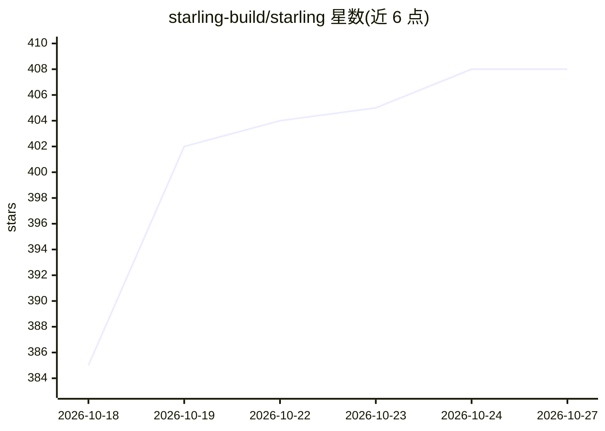

# starling-build/starling

⭐ 408 · Swift · Apache-2.0 · 推送 2026-10-26 · [GitHub](https://github.com/starling-build/starling) · [官网](https://starling.build) · 组织维护

**Swift 编写的 Linux 桌面环境：自带 Wayland 合成器与终端/办公套件**

Starling 是一个围绕 Swift 语言构建的 Linux 桌面环境及应用工厂：包含自带 Wayland 合成器与 X11 服务器的桌面 shell（含浮动/平铺窗口与 3D 城市视图）、支持持久会话的终端、浏览器可用的 Writer/Slides/Sheets 办公套件，以及将 Flutter 框架移植到 Swift（无 Dart VM）的 SDK。桌面目标平台为 Ubuntu 与 WSL2 上的 Windows；构建需先编译 starling-engine（Flutter 引擎 fork），再 swift build 各包，最终可打包为 deb。各应用成熟度不一且仍在活跃开发。

## 筛选速览

| 维度 | 判定 | 备注 |
|---|---|---|
| AI 角色 | `ai-enhanced` | 去掉 AI 部分产品仍成立 |
| 许可风险 | `permissive` | Apache-2.0 |
| 部署形态 | `None` |  |
| 模型依赖 | — | README 未给出锁定关系 |
| 硬件要求 | — | 无带数字的原话,不猜 |
| 安装摩擦 | `medium` | 含编译或系统依赖之一 |
| 成熟度 | `idea` | |

## 能力要点

- 自带 Wayland 合成器与 X11 服务器的桌面 shell，浮动与平铺窗口及 agent 专用工作区
- Flutter 框架的 Swift 移植（sdk/），基于 Flutter 引擎 C 核心，无 Dart VM
- 终端支持持久会话（termd 守护进程）、SSH 与远程工作区，有 macOS/Windows/Linux 构建
- 办公套件（Writer/Slides/Sheets）可在浏览器中直接试用，与原生构建共享 Swift 实现

## 适用场景

- 在 Ubuntu 上使用以 Swift 构建的独立 Linux 桌面环境
- 获得终端、办公套件与桌面一体化的第一方应用组合
- 基于 Flutter 引擎的 Swift SDK 开发自己的桌面应用

## 场景标签

 · 领域:操作系统/桌面环境

## 证据(README 行号)

> L21: |**Starling Desktop**|A native desktop with its own Wayland compositor and X11 server, built-in tools, floating and
> L39: The desktop brings the same approach to the whole workspace: its dock, menus,

## 星数曲线

2026-10-18 385 → 2026-10-27 408（+23）

---
*卡片 v1 · prompt 1.4 · 生成 2026-10-21 · 置信度 high · 依据 README sha `85757dfea26b` · [字段定义](../../DATASET.md)*
