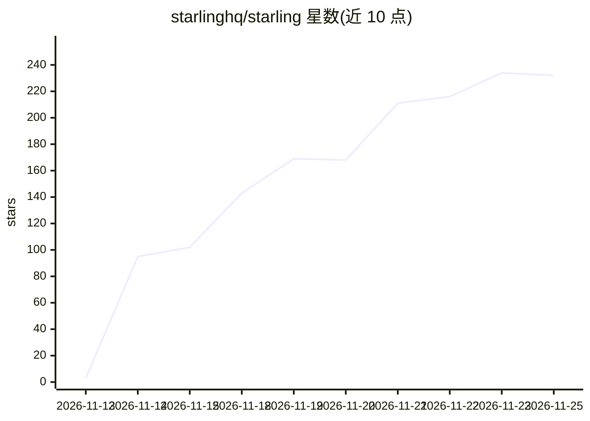

# starlinghq/starling

⭐ 232 · C# · Apache-2.0 · 推送 2026-11-22 · [GitHub](https://github.com/starlinghq/starling) · [官网](https://starling.rocks) · 组织维护

**面向 .NET 开发者的本地 AI 模型 NuGet 包：免 Python 免 API key**

把开源模型打包成普通 NuGet 库，提供文本/图像/视频嵌入、零样本实体抽取、聊天与文本生成能力，运行于 ONNX Runtime（CPU 或 CUDA），并通过 Microsoft.Extensions.AI（IEmbeddingGenerator、IChatClient）接入，使原本面向托管 provider 的代码只需改一行调用即可切到本地模型。每个模型固定到上游 commit、经 SHA-256 校验并与 Python 参考实现做数值比对后才发布。限制：嵌入切换后需重建索引，小模型不等同于大型托管模型；CUDA 稳定性仅在 Linux x64 + RTX 3090 验证。需要 .NET 10 SDK。

## 筛选速览

| 维度 | 判定 | 备注 |
|---|---|---|
| AI 角色 | `ai-ecosystem` | LLM/agent 周边工具 |
| 许可风险 | `permissive` | Apache-2.0 |
| 部署形态 | `None` |  |
| 模型依赖 | — | README 未给出锁定关系 |
| 硬件要求 | — | 无带数字的原话,不猜 |
| 安装摩擦 | `medium` | 含编译或系统依赖之一 |
| 成熟度 | `idea` | |

## 能力要点

- 模型打包为 NuGet 库，进程内离线运行，无 Python sidecar 与 API key
- 通过 Microsoft.Extensions.AI 接入，从托管 provider 迁移只需改动一行调用点
- 十二阶段交付管线：模型固定 commit、SHA-256 校验、与 Python 参考实现做数值奇偶校验
- 支持 CPU 与 CUDA，CI 拒绝任何 Azure/OpenAI SDK 依赖

## 适用场景

- 在 .NET 应用中本地运行嵌入、实体抽取与聊天，数据不出本机
- 把已写好的托管 embedding/chat 调用切换为本地模型
- 用文本查询检索本地照片文件夹（图文统一嵌入空间）

## 场景标签

`语义搜索` `多模态` `推理引擎` · 领域:知识与检索

## 证据(README 行号)

> L13: Starling packages open models as ordinary NuGet libraries: embeddings, entity extraction, image and video search, a
> L169: Starling depends only on the vendor-neutral `Microsoft.Extensions.AI.Abstractions`. CI rejects any Azure or OpenAI

## 星数曲线

2026-11-13 3 → 2026-11-25 232（+229）

---
*卡片 v1 · prompt 1.4 · 生成 2026-11-17 · 置信度 high · 依据 README sha `9b438fd10226` · [字段定义](../../DATASET.md)*
