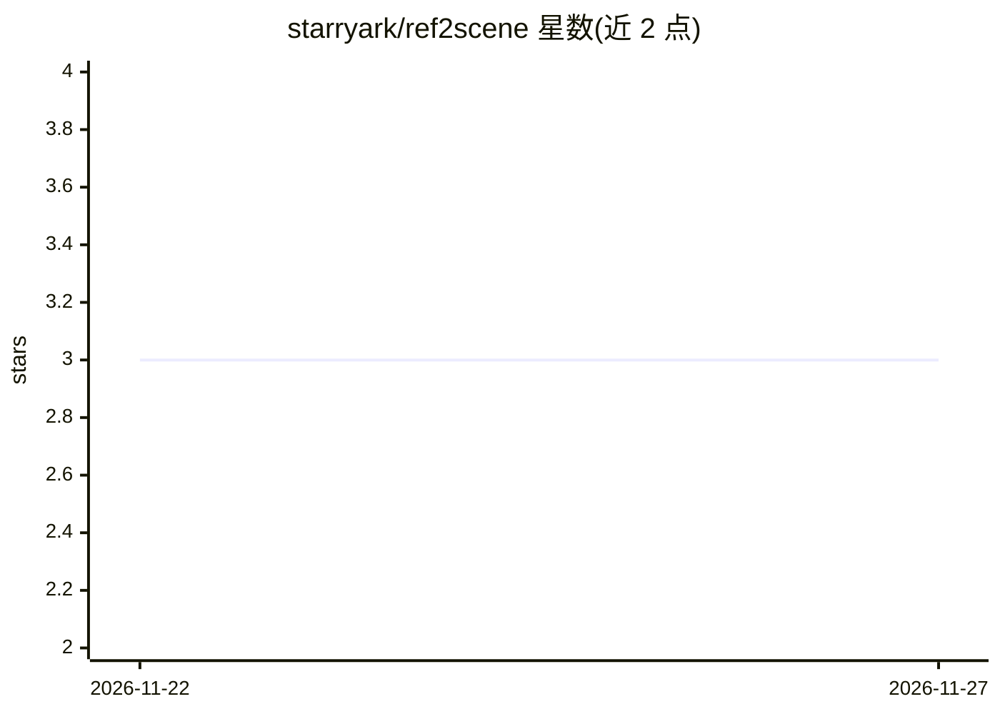

# starryark/ref2scene

⭐ 3 · Python · MIT · 推送 2026-10-29 · [GitHub](https://github.com/starryark/ref2scene) · 个人维护

**把参考照片变成可编辑、相机匹配的 Blender 场景的工具包**

一套命令行工具包与 Claude Code 工作流：编码 agent 读取照片，划分程序化几何与生成资产，并为每个物体写出 GPT Image 2.5 四视角（前/左/右/后）提示词；用户手动在 ChatGPT 生成图像、上传到 Tripo 网页版多视图图生 3D，工具包随后用数值检查每个交接环节（轮廓 IoU、高度漂移、细条数量），从消失线与尺度锚点拟合相机到照片，并在无头 Blender 中构建并复核场景。要求 Blender 5.2+ 与 Python 3.10+，设计上不调用 OpenAI/Tripo API、无需 API key。

## 筛选速览

| 维度 | 判定 | 备注 |
|---|---|---|
| AI 角色 | `ai-native` | 本体是模型或模型工具 |
| 许可风险 | `permissive` | MIT |
| 部署形态 | `library` | 以包/库形式分发 |
| 模型依赖 | — | README 未给出锁定关系 |
| 硬件要求 | — | 无带数字的原话,不猜 |
| 安装摩擦 | `low` | 无编译、无系统依赖或容器化 |
| 成熟度 | — | 结构信号不足 |

## 能力要点

- 每物体四视角提示词生成，提示词字节级确定性可复现
- 数值化门禁：镜像轮廓 IoU、高度漂移、模型-视图轮廓比对、细条计数
- 基于消失线与尺度锚点的相机拟合，输出残差与不确定度
- 无需 API key：生成器由用户手动运行，仓库不调用任何生成 API

## 适用场景

- 把室内照片重建为 Blender 中每个物体都可编辑的场景
- 为多视图图生 3D 流程生成并质检四视角参考图
- 用脚本方式将 Blender 相机匹配到照片（含残差与不确定度）
- AI 生成 3D 资产入场景前的质量检查

## 场景标签

`图像生成` · 领域:内容生成

## 证据(README 行号)

> L8: **Turn one or a few reference photos of a real place into an editable, camera-matched Blender
> L36: GPT Image 2.5 and Tripo are used **by hand, by design**. Nothing in this repository calls the
> L106: Requirements: Blender 5.2+, Python 3.10+, a ChatGPT account with

## 星数曲线

2026-11-22 3 → 2026-11-27 3（+0）

---
*卡片 v1 · prompt 1.4 · 生成 2026-11-22 · 置信度 high · 依据 README sha `a421faceab06` · [字段定义](../../DATASET.md)*
