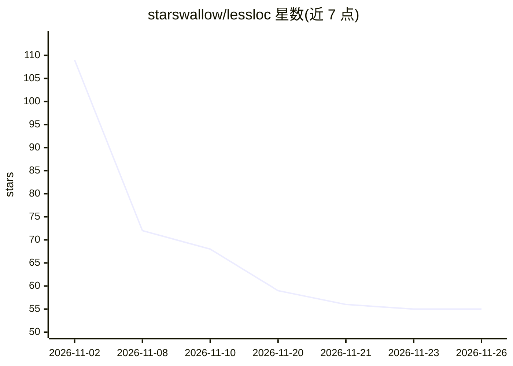

# starswallow/lessloc

⭐ 55 · JavaScript · Apache-2.0 · 推送 2026-10-26 · [GitHub](https://github.com/starswallow/lessloc) · [官网](https://lessloc.org) · 个人维护

**约束 AI 编程代理少写代码的钩子/插件工具**

面向 Claude Code、Codex、OpenCode、GitHub Copilot、Gemini CLI、Cursor 等 AI 编程代理的轻量工具：通过 hooks/插件接入代理流程，促使代理复用项目已有代码、拒绝占位符与注释掉的代码、在声明完成前重跑测试修复失败。README 声称在真实任务测量中减少代码量与 token 费用且结果不变。安装方式为让代理按 install.md 指引自行配置，Claude Code 另有插件市场命令；Apache-2.0 开源，无账号、无 API key、无依赖，仅每日检查新版本一次网络联系。

## 筛选速览

| 维度 | 判定 | 备注 |
|---|---|---|
| AI 角色 | `ai-ecosystem` | LLM/agent 周边工具 |
| 许可风险 | `permissive` | Apache-2.0 |
| 部署形态 | `None` |  |
| 模型依赖 | — | README 未给出锁定关系 |
| 硬件要求 | — | 无带数字的原话,不猜 |
| 安装摩擦 | `low` | 无编译、无系统依赖或容器化 |
| 成熟度 | — | 结构信号不足 |

## 能力要点

- 通过 hooks/插件接入多种 AI 编程代理（Claude Code/Codex/Copilot/Gemini CLI/Cursor 等）
- 拒绝占位符、注释掉的代码与备份文件，复用项目已有代码
- 代理声明完成前重跑测试，失败则回退修复
- 无账号、无 API key、无依赖，仅每日检查一次新版本发布

## 适用场景

- 让 AI 编程代理产出更少、更可审查的代码
- 降低 AI 编程任务的 token 消耗成本
- 拦截代理生成的占位符与无用代码

## 场景标签

`代码审查` · 领域:编码与开发

## 证据(README 行号)

> L7:  For Claude Code, Codex, OpenCode, GitHub Copilot, Gemini CLI, Cursor and many more.
> L23: Claude Code? Or type these in its prompt box:

## 星数曲线

2026-11-02 109 → 2026-11-26 55（-54）

---
*卡片 v1 · prompt 1.4 · 生成 2026-11-18 · 置信度 high · 依据 README sha `746955bce617` · [字段定义](../../DATASET.md)*
