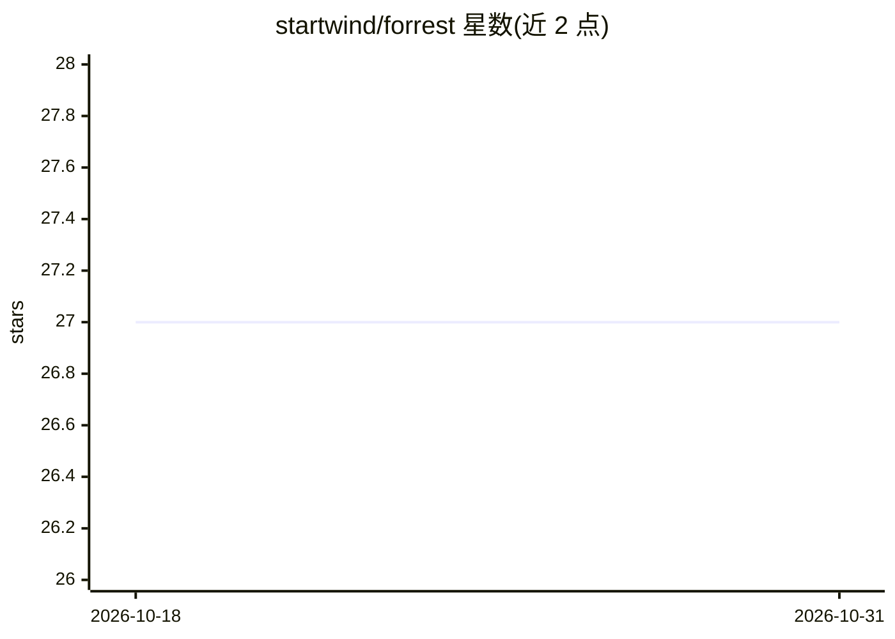

# startwind/forrest

⭐ 27 · PHP · MIT · 推送 2026-05-28 · [GitHub](https://github.com/startwind/forrest) · [官网](https://forrestcli.com) · 组织维护

**集中存储与检索命令行命令的 CLI 工具，含 AI 问答兜底**

PHP 编写的命令行工具：将常用命令集中存储为可参数化、可按名称/描述/参数搜索的条目，支持按文件（如 zip）、模式（如 WordPress）或命令名查找并执行命令；查找未命中时可向其大语言模型提问（forrest ask）获取解决方案。提供官方命令目录与自定义仓库扩展机制，配套 SaaS 搜索引擎。以 PHAR 单文件分发，运行需本机已安装 PHP。

## 筛选速览

| 维度 | 判定 | 备注 |
|---|---|---|
| AI 角色 | `ai-enhanced` | 去掉 AI 部分产品仍成立 |
| 许可风险 | `permissive` | MIT |
| 部署形态 | `None` |  |
| 模型依赖 | — | README 未给出锁定关系 |
| 硬件要求 | — | 无带数字的原话,不猜 |
| 安装摩擦 | `low` | 无编译、无系统依赖或容器化 |
| 成熟度 | — | 结构信号不足 |

## 能力要点

- 按文件名/文件类型返回相关命令（如 forrest run latest.zip）
- 数据库无匹配时通过 LLM 回答问题（forrest ask）
- 官方命令目录与自定义仓库扩展机制
- PHAR 单文件分发

## 适用场景

- 记不住命令参数时按文件或任务描述查找命令
- 团队集中共享常用命令与参数化脚本
- 查不到命令时向 AI 提问获取解决方案

## 场景标签

 · 领域:开发者工具/命令行

## 证据(README 行号)

> L64: forrest ask [question]
> L67: Forrest is AI powered. That means, if we do not find a matching command in our database you can ask our large langu

## 星数曲线

2026-10-18 27 → 2026-10-31 27（+0）

---
*卡片 v1 · prompt 1.4 · 生成 2026-10-26 · 置信度 high · 依据 README sha `705622dd9061` · [字段定义](../../DATASET.md)*
