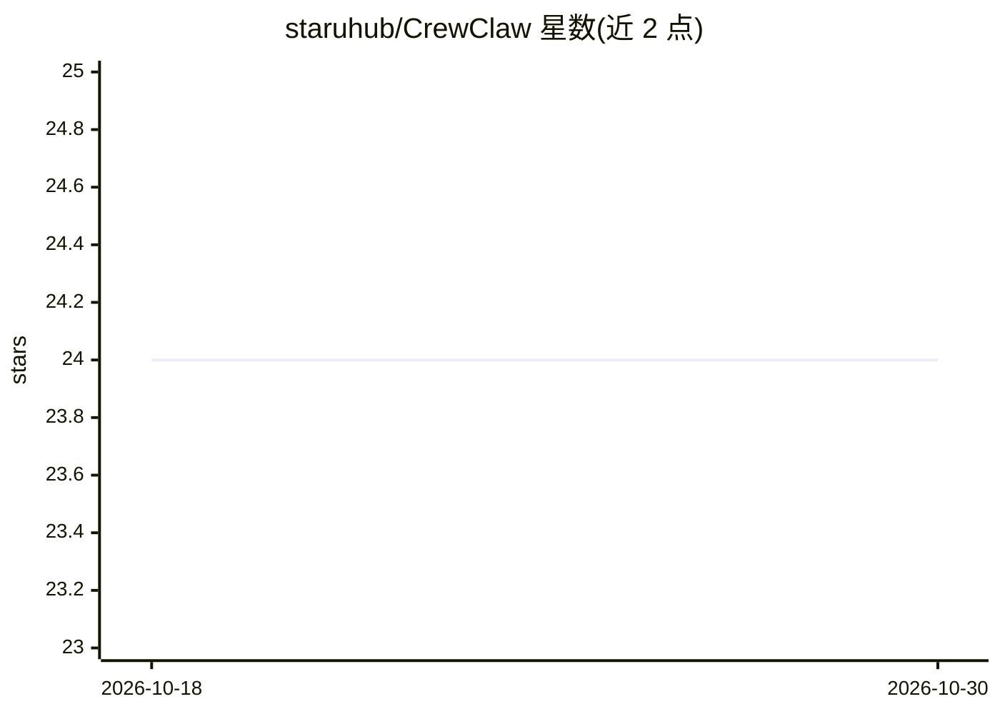

# staruhub/CrewClaw

⭐ 24 · JavaScript · Apache-2.0 · 推送 2026-10-25 · [GitHub](https://github.com/staruhub/CrewClaw) · [官网](https://crewhire.fly.dev/) · 个人维护 · 中文 README

**本地优先的 AI 员工平台：发现、雇佣、监督、验收 AI 员工**

CrewClaw 是一个本地优先的 AI Employee OS（Beta 0.8 prerelease），面向需要以‘雇佣员工’方式管理 AI agent 的开发者。核心机制：AI 员工市场、两文件员工标准（hire.yaml + crewclaw.employee.yaml）、开工前 Doctor 门禁检查、能力级权限分级、证据优先交付（无可检查证据的产物不能通过验收）、人工审批与基于本地运行记录的 KPI。由 Node TaskEvent 参考运行时、Rust/Ratatui 监督驾驶舱（TUI）与 Vite+React Web 界面组成，通过 Hermes 分发与执行。当前分发方式为从源码运行，接口与打包方式在 Beta 阶段可能变化；不负责通用聊天工作台与编辑器/浏览器等功能（属 OpenWork）。

## 筛选速览

| 维度 | 判定 | 备注 |
|---|---|---|
| AI 角色 | `ai-ecosystem` | LLM/agent 周边工具 |
| 许可风险 | `permissive` | Apache-2.0 |
| 部署形态 | `None` |  |
| 模型依赖 | — | README 未给出锁定关系 |
| 硬件要求 | — | 无带数字的原话,不猜 |
| 安装摩擦 | `low` | 无编译、无系统依赖或容器化 |
| 成熟度 | `idea` | |

## 能力要点

- 两文件员工标准固化岗位、运行时与验收合同
- Doctor 门禁：开工前检查合同、权限、工具、记忆、预算与证据捕获
- 能力级权限分级，高风险动作暂停等待人工授权
- 证据优先交付：无可检查证据的产物不能通过验收

## 适用场景

- 从市场发现 AI 员工并审查其许可、证据级别与能力边界
- 以雇佣-试工-验收流程监督 AI 员工执行任务并检查证据
- 用 Rust TUI Workbench 查看动作、成本、证据与审批

## 场景标签

`Agent 框架` · 领域:Agent 开发

## 证据(README 行号)

> L20: CrewClaw 是一个本地优先的 AI 员工平台：从市场发现候选人，审查合同与权限，完成 Doctor 检查和试工，再监督任务、检查证据、人工验收并用真实表现更新 KPI。
> L24: > CrewClaw 负责判断一位 AI 员工是否安全、可靠、值得雇佣；OpenWork 当前提供本地桌面任务、审批、历史、记忆与技能管理，并通过 Hermes 执行已批准工作。
> L60: - **Doctor 门禁**：开工前检查合同、权限、工具、记忆、预算、运行时和证据捕获。

## 星数曲线

2026-10-18 24 → 2026-10-30 24（+0）

---
*卡片 v1 · prompt 1.4 · 生成 2026-10-27 · 置信度 high · 依据 README sha `f18c9d3b4464` · [字段定义](../../DATASET.md)*
