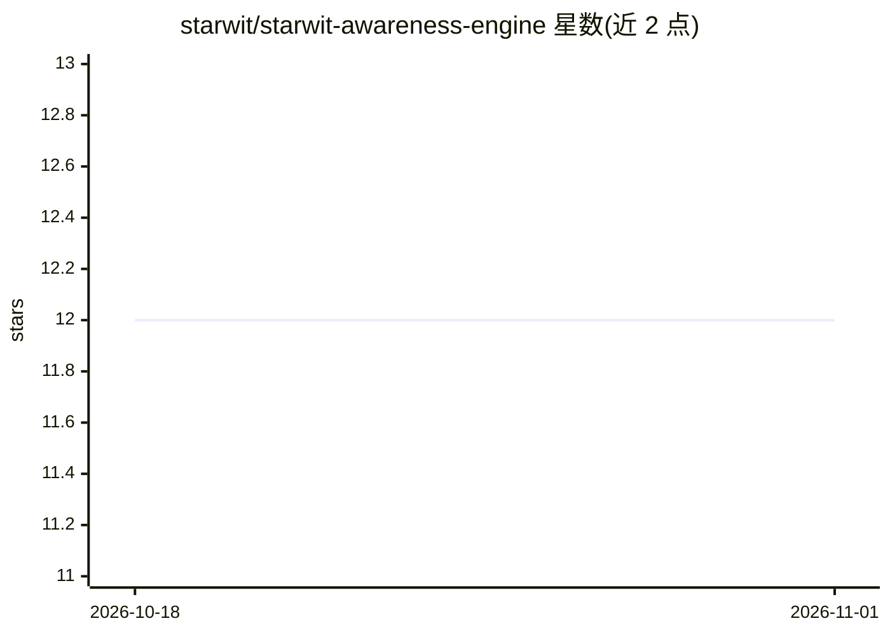

# starwit/starwit-awareness-engine

⭐ 12 · Jupyter Notebook · AGPL-3.0 · 推送 2026-10-19 · [GitHub](https://github.com/starwit/starwit-awareness-engine) · 组织维护

**计算机视觉管道编排仓库：视频目标检测、跟踪与地理映射**

Starwit Awareness Engine 的伞形仓库，汇集文档与编排代码，链接视频源接入、目标检测、目标跟踪、地理映射、检测聚合、Redis/数据库写入等十余个组件仓库。支持 Kubernetes（Helm）、Docker Compose 与 APT 包三种部署方式，组件间通过 Redis streams 通信，可本地挂入运行中的管道调试。附 sae-introspection 工具箱用于查看运行管道、可视化标注帧与在地图上绘制对象。面向构建视频分析管道的开发者，含 Nvidia K3s 配置文档。

## 筛选速览

| 维度 | 判定 | 备注 |
|---|---|---|
| AI 角色 | `ai-native` | 本体是模型或模型工具 |
| 许可风险 | `viral` | AGPL-3.0 |
| 部署形态 | `self-host` | docker 或自建部署 |
| 模型依赖 | — | README 未给出锁定关系 |
| 硬件要求 | — | 无带数字的原话,不猜 |
| 安装摩擦 | `low` | 无编译、无系统依赖或容器化 |
| 成熟度 | — | 结构信号不足 |

## 能力要点

- 组件化视觉管道：检测、跟踪、地理映射、聚合、存储写入
- Kubernetes/Helm、Docker Compose、APT 三种部署方式
- 组件间通过 Redis streams 通信，支持本地调试挂接
- sae-introspection 工具箱可视化帧标注与地图绘制

## 适用场景

- 接入摄像头视频流做目标检测与跟踪
- 将检测到的对象位置映射到地理坐标
- 在地图上查看和回放管道处理结果

## 场景标签

`目标检测` · 领域:感知与多模态

## 证据(README 行号)

> L2: This is an umbrella repository containing much of the documentation and orchestration code for the Starwit Awareness
> L20: The components of the vision pipeline can be found in the following repositories:

## 星数曲线

2026-10-18 12 → 2026-11-01 12（+0）

---
*卡片 v1 · prompt 1.4 · 生成 2026-11-01 · 置信度 high · 依据 README sha `3cfaf94e9bf3` · [字段定义](../../DATASET.md)*
