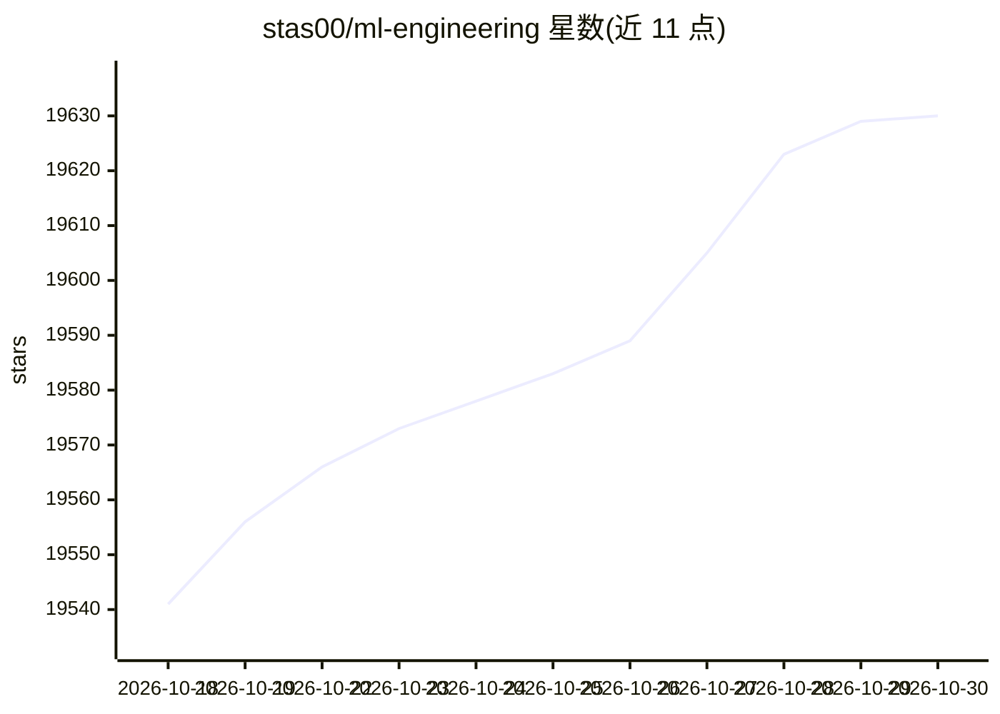

# stas00/ml-engineering

⭐ 19,630 · Python · CC-BY-SA-4.0 · 推送 2026-10-27 · [GitHub](https://github.com/stas00/ml-engineering) · [官网](https://stasosphere.com/machine-learning/) · 个人维护

**面向 LLM 训练工程师的训练/微调/推理方法论开源手册**

作者基于参与 BLOOM-176B、IDEFICS-80B 训练及 Contextual.AI 工作的经验整理的开放技术手册，覆盖大语言模型与多模态模型的训练、微调和推理的方法论、工具与逐步操作说明。内容以脚本和可复制粘贴的命令为主，供 LLM/VLM 训练工程师和运维人员使用。提供 PDF/EPUB 电子书版本，附两个供 AI agent 使用的 SKILL.md 文件、网络吞吐与 TFLOPS 基准测试脚本、PyTorch 调试与 slurm 速查指南，以及加速器与网络的对比表格。以 CC BY-SA 4.0 分发。

## 筛选速览

| 维度 | 判定 | 备注 |
|---|---|---|
| AI 角色 | `ai-knowledge` | 知识聚合/清单类 |
| 许可风险 | `viral` | CC-BY-SA-4.0 |
| 部署形态 | `None` |  |
| 模型依赖 | — | README 未给出锁定关系 |
| 硬件要求 | — | 无带数字的原话,不猜 |
| 安装摩擦 | `low` | 无编译、无系统依赖或容器化 |
| 成熟度 | — | 结构信号不足 |

## 动量与使用信号

- 维护:`active` — 距上次 push 1.4 天,年发版 0,51 位贡献者
- 涨星:近 1 天 **+9**(自 20261016 起算)
- 平台:LINUX · 协议:—

## 能力要点

- 提供脚本与可直接复制的命令，覆盖 LLM/VLM 训练、微调与推理
- 附 torch-dist-bench、mamf-finder 等网络与 TFLOPS 基准工具
- 提供两个 SKILL.md 文件用于训练 AI agent
- 提供 PDF/EPUB 电子书格式，托管于 Hugging Face Hub

## 适用场景

- 排查分布式 PyTorch 训练中的挂起或中断问题
- 大规模训练前测试节点间网络连通性与吞吐
- 测量加速器实际可达的 TFLOPS 水平
- 快速查阅 slurm 用法与技巧

## 场景标签

`教程课程` · 领域:学习与行业

## 证据(README 行号)

> L5: This is an open collection of methodologies, tools and step by step instructions to help with successful training an
> L7: This is a technical material suitable for LLM/VLM training engineers and operators. That is the content here contain
> L31: I maintain two SKILL.md files that you can use to teach your AI agent:

## 星数曲线

2026-10-18 19,541 → 2026-10-30 19,630（+89）

---
*卡片 v1 · prompt 1.4 · 生成 2026-10-18 · 置信度 high · 依据 README sha `3ee168580017` · [字段定义](../../DATASET.md)*
