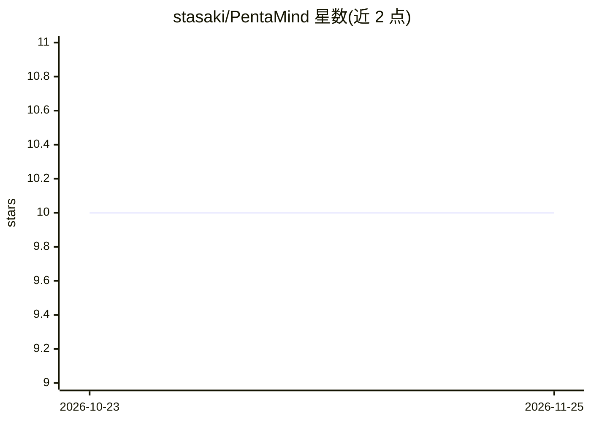

# stasaki/PentaMind

⭐ 10 · Python · BSD-3-Clause · 推送 2026-10-15 · [GitHub](https://github.com/stasaki/PentaMind) · [官网](https://huggingface.co/stasaking/pentamind) · 组织维护

**从五边形临摹图预测整体认知水平的深度学习模型**

基于 VGG19 的 PyTorch 回归模型，输入五边形临摹扫描图（224×224 RGB），输出整体认知分数；由 10 折交叉训练的 10 个模型取平均得到更稳定的结果，权重托管在 Hugging Face（5.6 GB，首次使用时自动下载）。提供 pentamind_predict.py 批量评分脚本，支持图像裁剪、测试时增强与特征导出。明确声明仅限研究用途，未经临床验证；训练人群、扫描设备受限，对新队列建议用分数做排序或回归变量而非绝对值。

## 筛选速览

| 维度 | 判定 | 备注 |
|---|---|---|
| AI 角色 | `ai-native` | 本体是模型或模型工具 |
| 许可风险 | `permissive` | BSD-3-Clause |
| 部署形态 | `library` | 以包/库形式分发 |
| 模型依赖 | — | README 未给出锁定关系 |
| 硬件要求 | — | 无带数字的原话,不猜 |
| 安装摩擦 | `medium` | 含编译或系统依赖之一 |
| 成熟度 | — | 结构信号不足 |

## 能力要点

- 10 折交叉训练模型取平均评分，输出含模型间标准差
- 支持 --crop 裁剪、TTA 测试时增强、--features 导出中间特征供训练自定义模型
- 权重托管于 Hugging Face，CPU 单张约 5 秒，GPU 可选加速
- 附论文原始复现脚本（训练/预测/五边形模拟器）

## 适用场景

- 对老年队列的五边形临摹扫描图批量估计认知分数
- 导出图像特征后在其上训练自己的认知相关模型
- 用模拟器研究线条形状、粗细等因素对评分的影响

## 场景标签

`科研工具` · 领域:学习与行业

## 证据(README 行号)

> L3: PentaMind is a deep learning model that predicts **global cognition** from a scanned drawing of
> L19: |Output|One number: predicted **global cognition** (higher = better cognition)|
> L116: - **Not a diagnostic tool.** PentaMind is for research. It has not been validated for clinical use.

## 星数曲线

2026-10-23 10 → 2026-11-25 10（+0）

---
*卡片 v1 · prompt 1.4 · 生成 2026-11-19 · 置信度 mid · 依据 README sha `908ecafb394d` · [字段定义](../../DATASET.md)*
