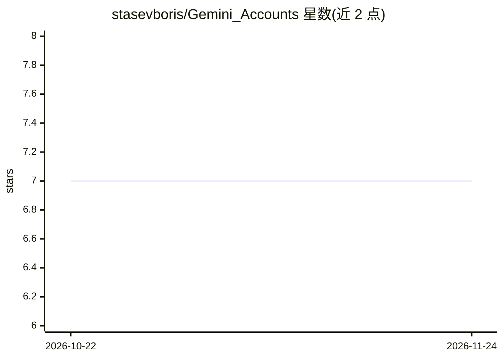

# stasevboris/Gemini_Accounts

⭐ 7 · Python · MIT · 推送 2026-10-16 · [GitHub](https://github.com/stasevboris/Gemini_Accounts) · 个人维护

**本地 LLM 网关：管理 Google 账号配额并为 Claude Code/Codex 配置客户端**

以 Windows 桌面应用（PySide6）与跨平台 CLI 形式运行的本地网关管理器：登录并池化 Google 订阅账号、ChatGPT 订阅账号、Claude 订阅账号与独立 API key，按配额重置时间自动路由请求，提供配额仪表盘、请求日志、账号优先级与配额预留设置。可自动配置 Claude Desktop、Claude Code CLI 与 Codex 的本地连接并支持恢复原配置。凭据经 DPAPI/Fernet 本地加密存储；生成仍在所选服务商端进行。

## 筛选速览

| 维度 | 判定 | 备注 |
|---|---|---|
| AI 角色 | `ai-ecosystem` | LLM/agent 周边工具 |
| 许可风险 | `permissive` | MIT |
| 部署形态 | `desktop` | 安装包/桌面程序 |
| 模型依赖 | locked-api |  |
| 硬件要求 | — | 无带数字的原话,不猜 |
| 安装摩擦 | `low` | 无编译、无系统依赖或容器化 |
| 成熟度 | — | 结构信号不足 |

## 能力要点

- Google/ChatGPT/Claude 订阅账号池与 API key 配置文件并存管理
- 按配额重置时间排序的自动路由与手动账号选择
- 一键配置 Claude Desktop/Claude Code CLI/Codex 并可还原原配置
- CLI 版本提供登录、状态、配置与 serve 监控命令

## 适用场景

- 把多个 Google 订阅账号的配额汇聚给本地 AI 客户端使用
- 为 Claude Code 和 Codex 批量配置本地网关与模型默认值
- 为团队管理多个 API key 配置文件并查看用量统计

## 场景标签

`模型网关` · 领域:Agent 开发

## 证据(README 行号)

> L1: Gemini Accounts — one local gateway for your models
> L29: |↻|**Automatic routing**|Uses enabled Google accounts, ranks available quota by reset time and handles provider ret
> L32: |⚡|**Client setup**|Connect Claude Desktop, Claude Code CLI and Codex. Original client configurations are backed up

## 星数曲线

2026-10-22 7 → 2026-11-24 7（+0）

---
*卡片 v1 · prompt 1.4 · 生成 2026-11-20 · 置信度 mid · 依据 README sha `39ac8058838f` · [字段定义](../../DATASET.md)*
