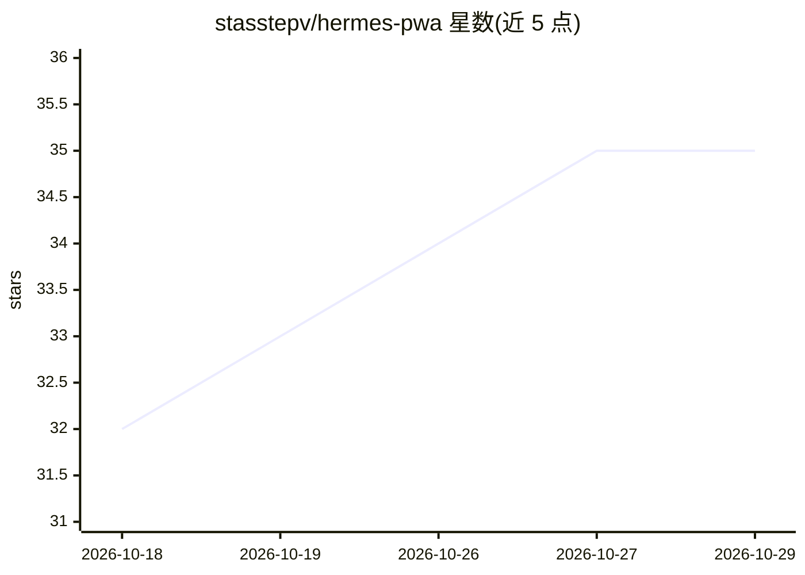

# stasstepv/hermes-pwa

⭐ 35 · TypeScript · MIT · 推送 2026-09-20 · [GitHub](https://github.com/stasstepv/hermes-pwa) · 个人维护

**Hermes Agent 的非官方手机 PWA 客户端插件**

以 Hermes Dashboard 插件形式安装的移动端渐进式 Web 应用：在 Dashboard 中新增 Mobile 标签并从中提供可安装到手机主屏的 PWA，复用现有 Dashboard 会话与同源认证，无需新建账号或 API key。功能包括流式聊天、批准/拒绝高影响 agent 操作、任务活动收件箱、项目看板、agent 与系统状态查看。作者声明为个人业余单干项目，处于 beta（0.1.2-beta），与 Nous Research 无关联，推荐经 Tailscale 私有网络访问。

## 筛选速览

| 维度 | 判定 | 备注 |
|---|---|---|
| AI 角色 | `ai-ecosystem` | LLM/agent 周边工具 |
| 许可风险 | `permissive` | MIT |
| 部署形态 | `library` | 以包/库形式分发 |
| 模型依赖 | — | README 未给出锁定关系 |
| 硬件要求 | — | 无带数字的原话,不猜 |
| 安装摩擦 | `low` | 无编译、无系统依赖或容器化 |
| 成熟度 | `idea` | |

## 能力要点

- 以 Dashboard 插件形式安装，复用同源会话认证，无新凭据
- 手机端聊天流式回复与高影响操作显式确认
- 活动收件箱：运行任务、委派与 cron 任务
- iOS Safari / Android Chrome 可安装到主屏

## 适用场景

- 在手机上与自己部署的 Hermes Agent 实例对话
- 外出时审批 agent 的高影响操作
- 随时查看 agent 任务、看板与系统状态

## 场景标签

`聊天机器人` · 领域:对话与助手

## 证据(README 行号)

> L5: A **plugin for the Hermes Agent Dashboard** — the web UI.
> L61: Hermes Mobile ships as a **Hermes Dashboard plugin**, not a separate web service. It runs on the **same origin**
> L64: - 🔑 **No new accounts, no API keys, no secrets in the client** — it reuses your existing Dashboard session.

## 星数曲线

2026-10-18 32 → 2026-10-29 35（+3）

---
*卡片 v1 · prompt 1.4 · 生成 2026-10-25 · 置信度 high · 依据 README sha `82f8ff8bfa69` · [字段定义](../../DATASET.md)*
