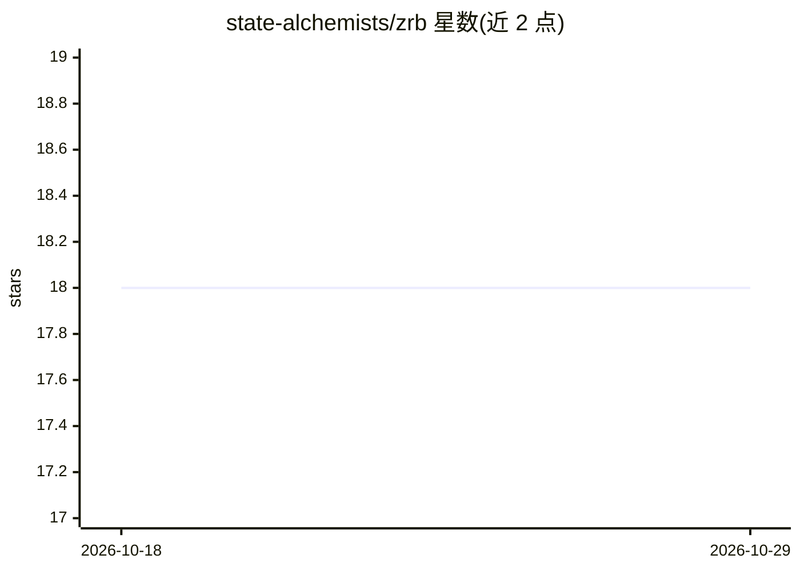

# state-alchemists/zrb

⭐ 18 · Python · 推送 2026-10-28 · [GitHub](https://github.com/state-alchemists/zrb) · [官网](https://pypi.org/project/zrb/) · 个人维护

**可编程进任务流水线的终端编码 agent 与构建系统**

Zrb 是以 Python 编写的终端编码 agent 与任务运行器：`zrb llm chat` 提供完整终端 agent 会话（读写文件、权限门控下执行命令、联网搜索、跨重启记忆，并可读取 `.claude/skills/` 与 `CLAUDE.md`）。其特点是将 LLMTask 作为 DAG 流水线中的一个节点，与 CmdTask、HttpCheck/TcpCheck 等确定性步骤编排，产物经 XCom 下游校验，任务以底层命令退出码结束以供 CI 分支。agent 的工具、钩子、权限策略、历史处理器均以 Python 在 zrb_init.py 中定义。支持 OpenAI（默认）、Anthropic、Gemini、Ollama、OpenRouter 等 provider，pip 安装，另有 Web UI（默认仅绑定 127.0.0.1）与 CI/CD 集成指南。

## 筛选速览

| 维度 | 判定 | 备注 |
|---|---|---|
| AI 角色 | `ai-ecosystem` | LLM/agent 周边工具 |
| 许可风险 | `none` | — |
| 部署形态 | `library` | 以包/库形式分发 |
| 模型依赖 | — | README 未给出锁定关系 |
| 硬件要求 | — | 无带数字的原话,不猜 |
| 安装摩擦 | `low` | 无编译、无系统依赖或容器化 |
| 成熟度 | — | 结构信号不足 |

## 能力要点

- LLMTask 可作为 DAG 流水线节点，与确定性步骤经 XCom 衔接
- agent 的工具/钩子/权限策略/动态提示/历史处理器均为 zrb_init.py 中的 Python 对象或回调
- 支持 Claude Code 的 skills、hooks 与 MCP servers 原样复用
- 同一任务定义可运行于终端、Web UI 与 CI

## 适用场景

- 在终端进行带权限门控的编码 agent 会话
- 把测试、部署等步骤固化为 DAG，保证 agent 无法跳过
- 用 Python 编排 LLM 与 shell 混合流水线并接入 CI/CD

## 场景标签

`编码 Agent` `工作流自动化` · 领域:效率与自动化

## 证据(README 行号)

> L9: The other half is why Zrb exists. A skill can *tell* an agent to run the tests before deploying; a DAG makes it impo
> L117: - 🤖 **A coding agent you program in Python.** Tools, hooks, prompts, permission policies and history processors ar
> L121: - 🧩 **Bring your Claude Code assets.** Skills, hooks and MCP servers work as-is.

## 星数曲线

2026-10-18 18 → 2026-10-29 18（+0）

---
*卡片 v1 · prompt 1.4 · 生成 2026-10-29 · 置信度 mid · 依据 README sha `2a06bb48a4fb` · [字段定义](../../DATASET.md)*
