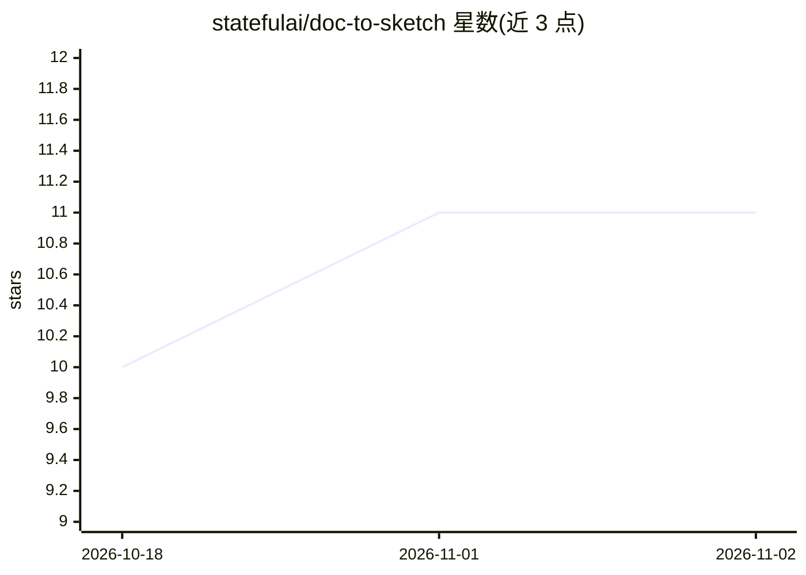

# statefulai/doc-to-sketch

⭐ 11 · Python · MIT · 推送 2026-10-10 · [GitHub](https://github.com/statefulai/doc-to-sketch) · 组织维护 · 中文 README

**把文档转为中文手绘技术解释图的 AI Skill**

面向 Claude Code、Codex、Cursor、Cline 等 agent 的 AI Skill：读取 Markdown、DOCX、PDF、PPTX、纯文本和飞书文档 URL，生成 21:9 封面图 + 16:9 正文配图（PNG）。提供三条路径：宿主原生图像生成直接出图、外部图像 API fallback、或仅输出 blueprint 与可粘贴到 ChatGPT/Midjourney 的 prompt 文件。另支持网站列表方形小图（共用风格档）、飞书 OAuth 只读读取、无人值守模式的生图上限与交叉审计回执。通过 npx skills 安装，也提供 git clone 源码方式。

## 筛选速览

| 维度 | 判定 | 备注 |
|---|---|---|
| AI 角色 | `ai-ecosystem` | LLM/agent 周边工具 |
| 许可风险 | `permissive` | MIT |
| 部署形态 | `library` | 以包/库形式分发 |
| 模型依赖 | — | README 未给出锁定关系 |
| 硬件要求 | — | 无带数字的原话,不猜 |
| 安装摩擦 | `low` | 无编译、无系统依赖或容器化 |
| 成熟度 | — | 结构信号不足 |

## 能力要点

- 支持 Markdown/DOCX/PDF/PPTX/飞书 URL 多种输入，输出 PNG 封面与正文配图
- 三条路径：原生出图 / 外部 API fallback / blueprint + prompt 规划
- 飞书文档 OAuth 只读授权，token 仅保存在本机
- 无人值守模式设生图上限并输出 sketch-receipt.jsonl 回执与交叉审计状态

## 适用场景

- 给我的文章生成封面图和正文配图
- 把训练营讲义转成中文手绘解释图
- 给网站列表里的每条内容配一张风格统一的方形小图
- 没有生图环境时先拿到规划 blueprint 和 prompt 自己去生成

## 场景标签

`图像生成` · 领域:内容生成

## 证据(README 行号)

> L5: doc-to-sketch 是一个把文档内容转换为**中文手绘技术解释图**的 AI Skill。
> L29: CLI 会检测已安装的 agent（Claude Code、Codex、Cursor、Cline 等），选择目标即可。全局安装加 `-g -y`。

## 星数曲线

2026-10-18 10 → 2026-11-02 11（+1）

---
*卡片 v1 · prompt 1.4 · 生成 2026-11-01 · 置信度 high · 依据 README sha `98212e989a77` · [字段定义](../../DATASET.md)*
