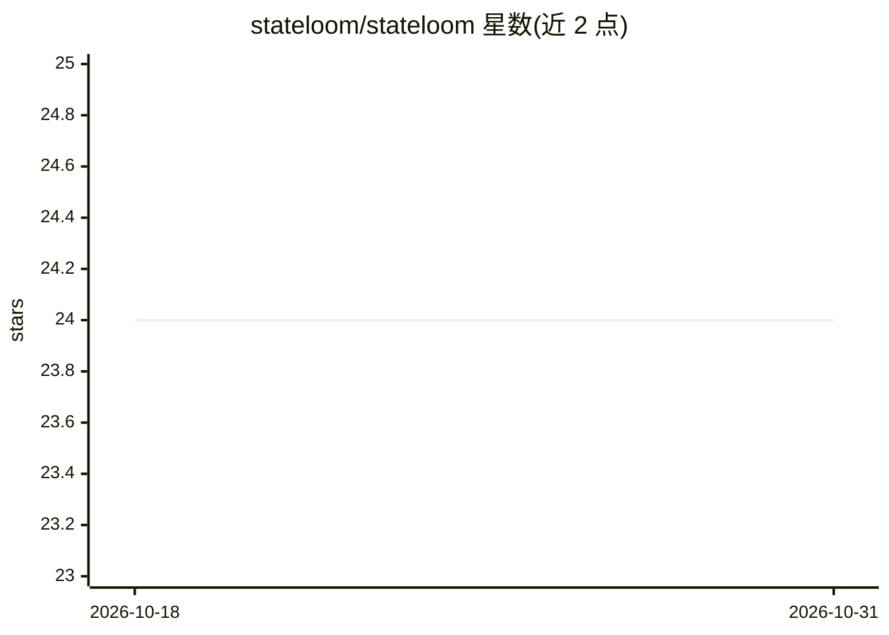

# stateloom/stateloom

⭐ 24 · Python · NOASSERTION · 推送 2026-06-21 · [GitHub](https://github.com/stateloom/stateloom) · [官网](https://stateloom.dev) · 组织维护

**面向 AI agent 的本地有状态控制平面：跟踪、安全与预算管控**

运行在请求路径中的本地中间件（localhost 或 VPC 内），将多步 agent 工作流聚合为有状态会话。核心能力：崩溃后从缓存断点恢复已完成步骤、会话级预算硬停、跨模型成本/token 归因、PII 检测与脱敏、提示注入护栏、kill switch、语义缓存与语义重试、时间旅行调试、VCR 录制回放测试。通过 pip 安装，自动检测并 patch 已安装的 LLM SDK（OpenAI/Anthropic/Gemini/Cohere/Mistral/LiteLLM），也可经环境变量接入 Claude Code、Gemini CLI、Codex 等订阅型 CLI，附带 localhost:4782 仪表盘。另有企业版（EE）提供 SSO/RBAC、层级计费等。

## 筛选速览

| 维度 | 判定 | 备注 |
|---|---|---|
| AI 角色 | `ai-ecosystem` | LLM/agent 周边工具 |
| 许可风险 | `none` | NOASSERTION |
| 部署形态 | `library` | 以包/库形式分发 |
| 模型依赖 | local-ok | 支持本地模型 |
| 硬件要求 | — | 无带数字的原话,不猜 |
| 安装摩擦 | `low` | 无编译、无系统依赖或容器化 |
| 成熟度 | — | 结构信号不足 |

## 能力要点

- 崩溃脚本从缓存断点恢复，不为已完成步骤重复付费
- 会话级预算硬停（如整次运行 $2 上限），支持 API key 与订阅
- PII 检测/脱敏/阻断、提示注入护栏、kill switch 与 CPython 审计钩子拦截外泄向量
- 自动 patch 已安装的 LLM SDK，CLI 工具零代码改动接入

## 适用场景

- 长时 agent 工作流崩溃后低成本断点续跑
- 团队为整条 agent 运行链路设成本上限并做跨模型成本归因
- 本地/私有网络内对 LLM 流量做 PII 与护栏合规审计
- 用现有 Claude/Gemini 订阅通过 CLI 获得观测与预算控制

## 场景标签

`LLM 可观测性` `Agent 记忆` · 领域:Agent 开发

## 证据(README 行号)

> L12: StateLoom is **session-aware**. Instead of seeing each API request in isolation, it sits in the request path and gr
> L94: Auto-detects and patches installed LLM clients:

## 星数曲线

2026-10-18 24 → 2026-10-31 24（+0）

---
*卡片 v1 · prompt 1.4 · 生成 2026-10-27 · 置信度 high · 依据 README sha `18f12e49a69d` · [字段定义](../../DATASET.md)*
