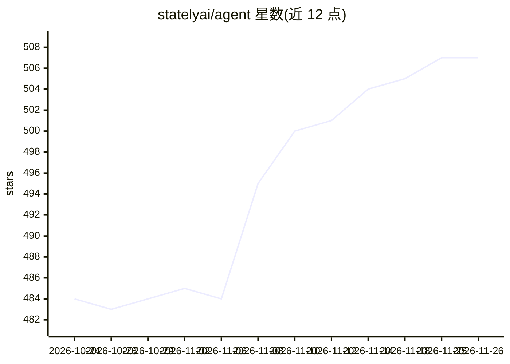

# statelyai/agent

⭐ 507 · TypeScript · MIT · 推送 2026-11-25 · [GitHub](https://github.com/statelyai/agent) · [官网](https://stately.ai/docs/agents) · 组织维护

**用 XState 状态机构建 LLM agent 的 TypeScript 框架**

在 XState 之上扩展模型请求与决策：状态机拥有控制流，模型只能从合法事件中选择，守卫拒绝越界选择。提供无 API key 的规则可达性验证（canReach）、基于事件日志的暂停恢复与回放（runAgent snapshot/replay）、新旧代码行为对齐检查（checkParity/checkConformance）、可流式接入 Stately inspector 可视化。核心不绑定 SDK，通过 Vercel AI SDK、OpenAI SDK、TanStack AI 等可选执行器对接模型。要求 Node 22+、TypeScript 5.4+、zod 等 Standard Schema 库，当前为 2.0 alpha。

## 筛选速览

| 维度 | 判定 | 备注 |
|---|---|---|
| AI 角色 | `ai-ecosystem` | LLM/agent 周边工具 |
| 许可风险 | `permissive` | MIT |
| 部署形态 | `library` | 以包/库形式分发 |
| 模型依赖 | — | README 未给出锁定关系 |
| 硬件要求 | — | 无带数字的原话,不猜 |
| 安装摩擦 | `low` | 无编译、无系统依赖或容器化 |
| 成熟度 | `idea` | |

## 能力要点

- 状态机约束模型只能选择合法事件，守卫拒绝越界决策
- 无模型调用的测试：canReach 证明规则，replay 从事件日志重建运行
- checkParity/checkConformance 对照旧代码检查迁移一致性
- 多种可选执行器适配 Vercel AI SDK / OpenAI SDK / TanStack AI，核心不导入 SDK

## 适用场景

- 把退款审批这类带硬性限额的业务规则接入 LLM 决策
- 将手写 while 循环的现有 agent 迁移为可验证的状态机
- 需要暂停/恢复、事件回放与运行可视化的长流程 agent
- 为 agent 编写按状态分层的 evals 与行为验证

## 场景标签

`Agent 框架` `模型评测` · 领域:Agent 开发

## 证据(README 行号)

> L5: Agent logic as state machines: deterministic, inspectable, resumable, runs anywhere. The machine owns control flow; 
> L15: Stately Agent adds model requests and decisions to XState:
> L18: - Your application chooses the model, runs the requests, and stores the state.

## 星数曲线

2026-10-24 484 → 2026-11-26 507（+23）

---
*卡片 v1 · prompt 1.4 · 生成 2026-11-26 · 置信度 high · 依据 README sha `f7a47a7b491b` · [字段定义](../../DATASET.md)*
