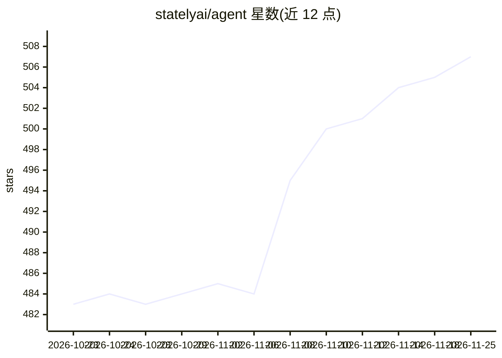

# statelyai/agent

⭐ 507 · TypeScript · MIT · 推送 2026-11-23 · [GitHub](https://github.com/statelyai/agent) · [官网](https://stately.ai/docs/agents) · 组织维护

**用 XState 状态机构建可验证、可恢复的 LLM Agent 的 TypeScript 库**

在 XState 之上扩展模型请求与决策能力的 TypeScript 库：状态机拥有控制流，模型只能从合法事件中选择，守卫拒绝非法提议。提供无需 API key 的不变式证明（canReach）、事件日志快照恢复与回放（runAgent/replay）、新旧代码对齐检查（checkParity/compareRuns）。通过 AI SDK、OpenAI SDK、TanStack AI 等可选执行器接入模型；提供 ReAct、RAG、supervisor 等单文件模式模板与配套 coding agent 技能。当前为 2.0 alpha，API 可能变动；需 Node 22+ 与 TypeScript 5.4+。

## 筛选速览

| 维度 | 判定 | 备注 |
|---|---|---|
| AI 角色 | `ai-ecosystem` | LLM/agent 周边工具 |
| 许可风险 | `permissive` | MIT |
| 部署形态 | `library` | 以包/库形式分发 |
| 模型依赖 | — | README 未给出锁定关系 |
| 硬件要求 | — | 无带数字的原话,不猜 |
| 安装摩擦 | `low` | 无编译、无系统依赖或容器化 |
| 成熟度 | `idea` | |

## 能力要点

- 模型仅提议事件，状态机守卫决定合法性，非法动作被结构性排除
- 事件日志快照支持恢复与无模型调用回放
- canReach 无 API key 证明不变式；checkParity 对齐被替换的旧代码
- 附 ReAct/plan-and-execute/RAG/supervisor 等单文件模式与 Claude Code 技能插件

## 适用场景

- 给 refund、工单分诊等流程加硬性规则边界
- 已有 agent 的 while 循环改造成可检查的状态机
- 需要断点恢复与运行回放的长时 Agent

## 场景标签

`Agent 框架` · 领域:Agent 开发

## 证据(README 行号)

> L5: Agent logic as state machines: deterministic, inspectable, resumable, runs anywhere. The machine owns control flow; 
> L15: Stately Agent adds model requests and decisions to XState:
> L19: - The model proposes an event; the machine decides whether it is allowed and what happens next.

## 星数曲线

2026-10-23 483 → 2026-11-25 507（+24）

---
*卡片 v1 · prompt 1.4 · 生成 2026-11-25 · 置信度 high · 依据 README sha `109207f35cf2` · [字段定义](../../DATASET.md)*
