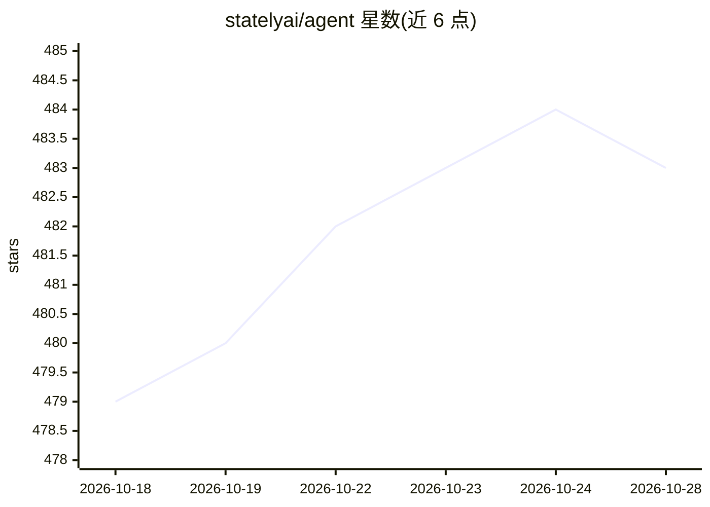

# statelyai/agent

⭐ 484 · TypeScript · MIT · 推送 2026-10-28 · [GitHub](https://github.com/statelyai/agent) · [官网](https://stately.ai/docs/agents) · 组织维护

**基于 XState 状态机构建 LLM agent 的 TypeScript 框架**

在 XState 之上为 LLM agent 增加模型请求与决策的框架：机器持有控制流，模型只能提出合法事件，由守卫判定是否放行。环境（TypeScript 状态与守卫）固定可验证，策略（JSON 机器）可由模型改写并经门控后按实测提升晋级。应用自行选择模型、执行请求并存储状态，核心包不直接依赖 AI SDK；可本地无 API key 测试并跨框架运行。当前处于 alpha 阶段，API 可能变动，需 Node 22.18+ 与 XState v6 alpha 版本。

## 筛选速览

| 维度 | 判定 | 备注 |
|---|---|---|
| AI 角色 | `ai-ecosystem` | LLM/agent 周边工具 |
| 许可风险 | `permissive` | MIT |
| 部署形态 | `library` | 以包/库形式分发 |
| 模型依赖 | — | README 未给出锁定关系 |
| 硬件要求 | — | 无带数字的原话,不猜 |
| 安装摩擦 | `low` | 无编译、无系统依赖或容器化 |
| 成熟度 | `idea` | |

## 能力要点

- 状态机持有控制流，模型只能从合法事件中选择，守卫拒绝违规提案
- 策略可由模型自行改写，经 verifyAgentConfig 门控与 held-out 场景实测后晋级
- 核心不导入 AI SDK，执行器显式接入，支持零机器改动跨框架运行
- 内置 ReAct、plan-and-execute、RAG、supervisor 等 agent 模式单文件示例

## 适用场景

- 把现有 while 循环 agent 重构为可控可测的状态机
- 需要守卫硬约束（如金额上限）的业务决策 agent
- 无 API key 本地测试 agent 逻辑后再接入真实模型

## 场景标签

`Agent 框架` · 领域:Agent 开发

## 证据(README 行号)

> L5: Agent logic as state machines: deterministic, inspectable, resumable, runs anywhere. The machine owns control flow; 
> L7: Stately Agent adds model requests and decisions to XState:
> L10: - Your application chooses the model, runs the requests, and stores the state.

## 星数曲线

2026-10-18 479 → 2026-10-28 483（+4）

---
*卡片 v1 · prompt 1.4 · 生成 2026-10-21 · 置信度 high · 依据 README sha `63f69df833bb` · [字段定义](../../DATASET.md)*
