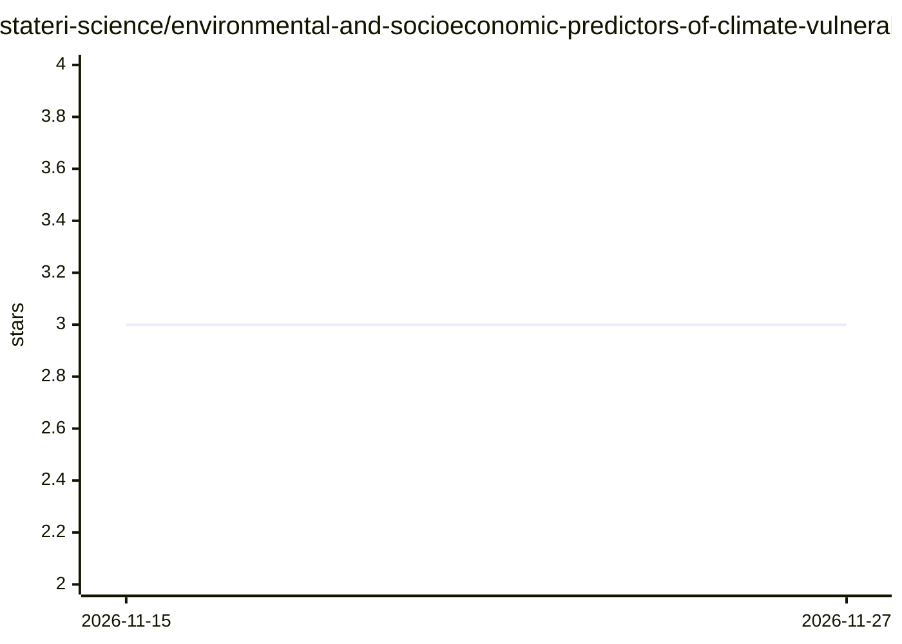

# stateri-science/environmental-and-socioeconomic-predictors-of-climate-vulnerability

⭐ 3 · R · MIT · 推送 2026-10-15 · [GitHub](https://github.com/stateri-science/environmental-and-socioeconomic-predictors-of-climate-vulnerability) · 个人维护

**菲律宾气候脆弱性预测因素的本科论文数据与代码存档**

菲律宾理工大学本科论文（2026年4月）的官方仓库，收录数据集、统计脚本与实证文档。研究覆盖菲律宾 17 个行政区 2010–2024 年面板数据，采用 MICE 多重插补、PCA 降维、带 Driscoll-Kraay 标准误的双向固定效应回归，并以 XGBoost 作非线性基准（含 PDP 与 SHAP 解释）。README 以图表和实证表格形式呈现主要发现，未包含安装或复现运行说明。

## 筛选速览

| 维度 | 判定 | 备注 |
|---|---|---|
| AI 角色 | `ai-knowledge` | 知识聚合/清单类 |
| 许可风险 | `permissive` | MIT |
| 部署形态 | `None` |  |
| 模型依赖 | — | README 未给出锁定关系 |
| 硬件要求 | — | 无带数字的原话,不猜 |
| 安装摩擦 | `low` | 无编译、无系统依赖或容器化 |
| 成熟度 | — | 结构信号不足 |

## 能力要点

- 17 个行政区 2010–2024 年面板数据集
- 双向固定效应回归 + XGBoost 互补分析框架
- MICE 多重插补与 PCA 构建综合指数（SEQI、不平等指数）
- SHAP 与 PDP 解释非线性阈值效应

## 适用场景

- 查找菲律宾次国家级气候脆弱性实证数据
- 参考面板回归与机器学习互补的研究设计
- 了解气候公正悖论的实证证据与政策含义

## 场景标签

 · 领域:气候/社会科学实证研究

## 证据(README 行号)

> L4: This repository contains the official dataset, statistical scripts, and empirical documentation for our undergraduat
> L19: This study utilizes a quantitative, non-experimental observational panel framework spanning all **17 administrative
> L27: 4. **Machine Learning Benchmark:**

## 星数曲线

2026-11-15 3 → 2026-11-27 3（+0）

---
*卡片 v1 · prompt 1.4 · 生成 2026-11-21 · 置信度 high · 依据 README sha `088646983866` · [字段定义](../../DATASET.md)*
