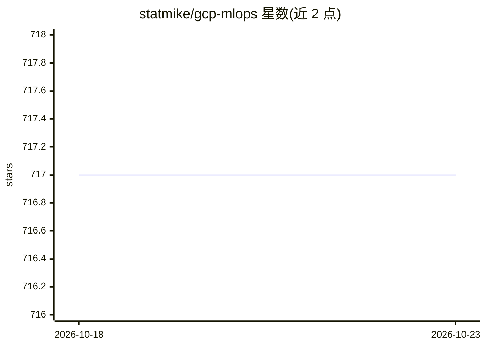

# statmike/gcp-mlops

⭐ 717 · Jupyter Notebook · Apache-2.0 · 推送 2026-10-21 · [GitHub](https://github.com/statmike/gcp-mlops) · 个人维护

**GCP 端到端 ML/MLOps/Data+AI/Agent 工作流笔记本库（580+）**

个人维护的 Google Cloud 数据与 AI 实践仓库（原 vertex-ai-mlops），收录 580+ 交互式笔记本与 85+ SQL 脚本，覆盖 BigQuery ML/AI 函数、基于 ADK/MCP/A2A 的 agent 架构、特征存储、模型服务、RAG 检索与多框架训练等主题；计算在 GCP 服务上执行而非本地。另以 PyPI 包 bigquery-data-science 形式发布从笔记本提炼的 Agent Skills、CLI 与 stdio MCP server，供 AI 编程 agent 复用验证过的模式。每个子目录附独立 readme 与目录索引。

## 筛选速览

| 维度 | 判定 | 备注 |
|---|---|---|
| AI 角色 | `ai-knowledge` | 知识聚合/清单类 |
| 许可风险 | `permissive` | Apache-2.0 |
| 部署形态 | `library` | 以包/库形式分发 |
| 模型依赖 | — | README 未给出锁定关系 |
| 硬件要求 | — | 无带数字的原话,不猜 |
| 安装摩擦 | `low` | 无编译、无系统依赖或容器化 |
| 成熟度 | — | 结构信号不足 |

## 能力要点

- 580+ 笔记本与 85+ SQL 脚本，覆盖训练、服务、agent、RAG 全栈
- 5 种特征存储架构与 11 种数据库向量检索的横向对比工作流
- 配套 bigquery-data-science 包提供 Agent Skills、CLI 与 stdio MCP server
- 计算在 Google Cloud 服务上运行，笔记本共享数据集便于方法对比

## 适用场景

- 在 GCP 上搭建训练、评估到服务的 MLOps 流程时寻找可运行起点
- 对比不同特征存储、服务模式与向量检索数据库的方案
- 为 AI 编程 agent 安装经过验证的 BigQuery ML/AI 技能包

## 场景标签

`MLOps` `RAG` `教程课程` · 领域:知识与检索

## 证据(README 行号)

> L28: This repository (`statmike/gcp-mlops`, formerly `vertex-ai-mlops`) has grown along that same path. It started as a 
> L35: Across this repository and its companion **`statmike/bigquery-data-science`** repository you will find **580+ inter

## 星数曲线

2026-10-18 717 → 2026-10-23 717（+0）

---
*卡片 v1 · prompt 1.4 · 生成 2026-10-21 · 置信度 mid · 依据 README sha `28a74534b293` · [字段定义](../../DATASET.md)*
