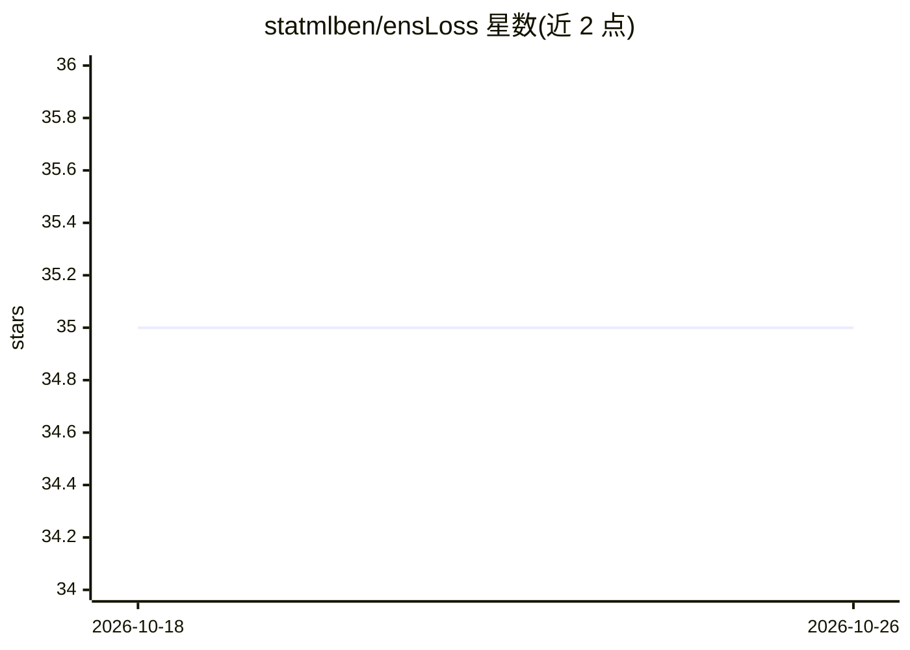

# statmlben/ensLoss

⭐ 35 · Python · MIT · 推送 2025-11-01 · [GitHub](https://github.com/statmlben/ensLoss) · 组织维护

**ICML 2025 论文 EnsLoss 官方代码：损失函数集成防过拟合**

ICML 2025 论文 EnsLoss 的官方实验仓库，面向科研人员。方法将集成学习思想引入 ERM 框架，在 SGD 中直接生成满足凸性与分类校准（CC）条件的随机损失导数，形成双重随机梯度，替代固定损失函数。仓库提供图像（CIFAR2/PCam）、表格（OpenML 14 数据集）、文本（SST2）三类基准的可复现代码，支持 VGG/ResNet/MobileNet/DenseNet/MLP/LSTM 等模型，并与 dropout、weight decay、数据增强等正则化方法做兼容性实验。结果通过 W&B 项目与 markdown 报告公开。

## 筛选速览

| 维度 | 判定 | 备注 |
|---|---|---|
| AI 角色 | `ai-native` | 本体是模型或模型工具 |
| 许可风险 | `permissive` | MIT |
| 部署形态 | `None` |  |
| 模型依赖 | — | README 未给出锁定关系 |
| 硬件要求 | — | 无带数字的原话,不猜 |
| 安装摩擦 | `low` | 无编译、无系统依赖或容器化 |
| 成熟度 | — | 结构信号不足 |

## 能力要点

- 在 SGD 中直接生成满足 CC 条件的随机损失导数（双重随机梯度）
- 图像/表格/文本三类基准的可复现实验代码（含 45 个 CIFAR2 与 14 个 OpenML 数据集）
- 覆盖 VGG/ResNet/MobileNet/DenseNet/TabMLP/LSTM 等模型与 dropout/weight decay/数据增强正则化组合
- 运行结果通过 W&B 项目与 markdown 报告公开

## 适用场景

- 复现论文在 CIFAR2/PCam/OpenML 上的对比实验
- 在自定义二分类数据集上运行或对比 EnsLoss 与固定损失
- 验证 EnsLoss 与现有正则化方法的兼容性

## 场景标签

`科研工具` · 领域:学习与行业

## 证据(README 行号)

> L33: In this project, we propose a novel loss ensemble method, namely **EnsLoss**, which extends the ensemble learning c
> L63: Different **loss functions** can be integrated with **various neural networks** and **regularization methods** to t

## 星数曲线

2026-10-18 35 → 2026-10-26 35（+0）

---
*卡片 v1 · prompt 1.4 · 生成 2026-10-25 · 置信度 high · 依据 README sha `5904d07bdc52` · [字段定义](../../DATASET.md)*
