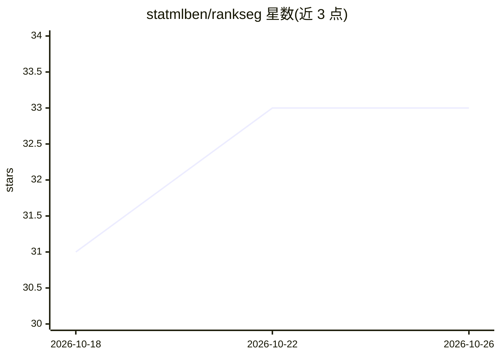

# statmlben/rankseg

⭐ 33 · Jupyter Notebook · MIT · 推送 2025-12-30 · [GitHub](https://github.com/statmlben/rankseg) · [官网](https://rankseg.readthedocs.io/en/latest/) · 组织维护

**直接优化 Dice/IoU 的图像分割预测框架**

JMLR 2023 论文的实验复现仓库，提供 RankDice 方法：对已训练分割网络输出的逐像素概率进行基于排序的推断，直接优化 Dice 与 IoU 指标，无需重训模型即可与任意预训练分割网络结合。软件包安装与使用另行发布在 rankseg/rankseg 仓库。本仓库含 rank_dice 函数、pytorch-segmentation-rankseg 复现子项目、Jupyter 示例及 Cityscapes/VOC 2012/Kvasir-SEG 上的对比结果，方法要求损失函数为严格 proper loss。

## 筛选速览

| 维度 | 判定 | 备注 |
|---|---|---|
| AI 角色 | `ai-native` | 本体是模型或模型工具 |
| 许可风险 | `permissive` | MIT |
| 部署形态 | `library` | 以包/库形式分发 |
| 模型依赖 | — | README 未给出锁定关系 |
| 硬件要求 | — | 无带数字的原话,不猜 |
| 安装摩擦 | `medium` | 含编译或系统依赖之一 |
| 成熟度 | — | 结构信号不足 |

## 能力要点

- rank_dice 函数基于概率输出直接优化 Dice/IoU
- 可接入任意预训练分割网络，无需重训
- 提供 Cityscapes/VOC 2012/Kvasir-SEG 的对比实验与复现代码
- 要求严格 proper loss（Soft-Dice 等损失不适用）

## 适用场景

- 在不重训模型的前提下提升分割的 Dice/IoU 指标
- 复现 JMLR 论文实验结果
- 在自有分割网络上替换阈值/argmax 推断方式

## 场景标签

`目标检测` · 领域:感知与多模态

## 证据(README 行号)

> L14: **RankSEG** is a Python module designed for segmentation tasks, aiming to maximize **Dice** or **IoU** metrics base
> L25: Our method, `RankDice`, directly optimizes IoU and Dice metrics.
> L28: - Seamlessly integrates with any pretrained segmentation neural network (*no need to retrain the models*).

## 星数曲线

2026-10-18 31 → 2026-10-26 33（+2）

---
*卡片 v1 · prompt 1.4 · 生成 2026-10-25 · 置信度 mid · 依据 README sha `cbb071cb3e24` · [字段定义](../../DATASET.md)*
