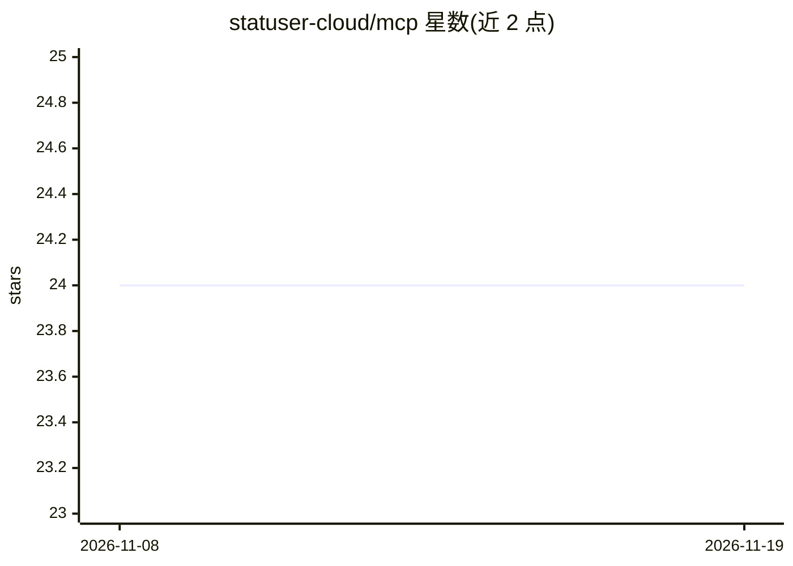

# statuser-cloud/mcp

⭐ 24 · TypeScript · MIT · 推送 2026-11-08 · [GitHub](https://github.com/statuser-cloud/mcp) · [官网](https://statuser.cloud) · 组织维护

**Statuser 监控服务的官方 MCP 服务器，供 AI 客户端管理服务器与状态页**

Statuser 官方发布的 Model Context Protocol 服务器，使 Claude Code、Cursor、VS Code、Windsurf、Claude Desktop 等 MCP 客户端通过 API 密钥直接操作 Statuser 账号：查看服务器状态与检查图表、处理事件（AI 摘要、PDF 报告、评论）、发布状态页事件报告与维护计划、配置通知规则与 Webhook。近 100 个工具分 8 组，可按组开关；写操作默认阻断，需环境变量或 confirm: true 确认。支持远程 Streamable HTTP 接入或本地 npx 运行（需 Node.js 18.17+），远程模式不支持本地文件上传与 SSE 传输。

## 筛选速览

| 维度 | 判定 | 备注 |
|---|---|---|
| AI 角色 | `ai-ecosystem` | LLM/agent 周边工具 |
| 许可风险 | `permissive` | MIT |
| 部署形态 | `library` | 以包/库形式分发 |
| 模型依赖 | — | README 未给出锁定关系 |
| 硬件要求 | — | 无带数字的原话,不猜 |
| 安装摩擦 | `low` | 无编译、无系统依赖或容器化 |
| 成熟度 | — | 结构信号不足 |

## 能力要点

- 近 100 个工具分 8 组，可按 toolsets 参数裁剪上下文占用
- 写操作默认阻断，支持永久放行（STATUSER_ALLOW_WRITE）或单次 confirm: true 确认
- 双接入方式：远程 Streamable HTTP（https://mcp.statuser.cloud）或本地 npx 运行
- 已发布至 MCP 官方注册表 io.github.statuser-cloud/mcp

## 适用场景

- 在 AI 编程客户端中直接查看服务器监控状态与事件诊断
- 让助手代为发布状态页事件报告和维护计划
- 通过对话配置通知规则、Webhook 与邮件渠道

## 场景标签

 · 领域:运维监控/MCP 工具

## 证据(README 行号)

> L7: MCP-сервер для управления Statuser из ИИ-клиента — Claude Code, Cursor, VS Code, Windsurf, Claude Desktop и любого д
> L9: С ним ассистент работает с вашим аккаунтом Statuser напрямую: смотрит состояние серверов, разбирает инциденты, публи

## 星数曲线

2026-11-08 24 → 2026-11-19 24（+0）

---
*卡片 v1 · prompt 1.4 · 生成 2026-11-18 · 置信度 high · 依据 README sha `64a6bc666ed1` · [字段定义](../../DATASET.md)*
