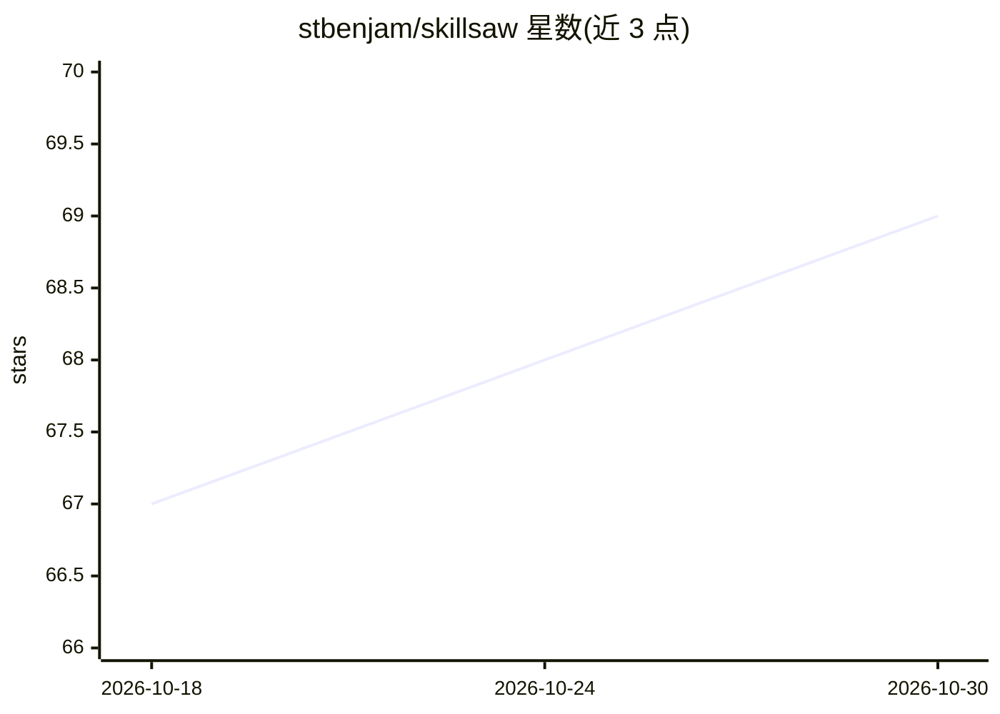

# stbenjam/skillsaw

⭐ 69 · Python · Apache-2.0 · 推送 2026-10-29 · [GitHub](https://github.com/stbenjam/skillsaw) · [官网](https://skillsaw.org/) · 个人维护

**AI 编码代理指令文件的 linter：校验结构与安全**

面向使用 AI 编码代理的团队的 lint 工具：校验 Claude Code、OpenAI Codex、Cursor、Copilot、Grok Build、Google Antigravity 等多种生态的 agent 指令与插件文件（SKILL.md、AGENTS.md、plugin.json、hooks.json、MCP 配置等）的结构与格式，并检测供应链风险（危险生命周期钩子、prompt 注入隐藏载荷、危险环境变量、嵌入凭据）。提供确定性自动修复、baseline 渐进采用、字母评级与多种输出格式（JSON/SARIF/HTML 等），支持本地、CI 与 agent 工作流。无需安装即可用 uvx 运行。

## 筛选速览

| 维度 | 判定 | 备注 |
|---|---|---|
| AI 角色 | `ai-ecosystem` | LLM/agent 周边工具 |
| 许可风险 | `permissive` | Apache-2.0 |
| 部署形态 | `library` | 以包/库形式分发 |
| 模型依赖 | — | README 未给出锁定关系 |
| 硬件要求 | — | 无带数字的原话,不猜 |
| 安装摩擦 | `low` | 无编译、无系统依赖或容器化 |
| 成熟度 | — | 结构信号不足 |

## 能力要点

- 覆盖十余种 AI 编码生态的结构与 schema 校验
- 供应链安全检查：RCE 钩子、不可见 Unicode 注入、高危环境变量、凭据
- 安全修复自动执行（skillsaw fix），其余给出面向 agent 的修复指引
- 每次运行输出基于违规密度的字母评级与报告卡

## 适用场景

- 团队统一审查 CLAUDE.md / AGENTS.md 等代理指令文件的质量
- 在 CI 或 PR 中拦截 agent 配置的供应链攻击与注入风险
- 把存量项目逐步纳入 lint 约束而不阻断现有工作

## 场景标签

 · 领域:开发工具/AI 代理配置

## 证据(README 行号)

> L7: A linter for the files that steer AI coding agents.
> L12: prose. skillsaw gives them a linter. It validates structure across every major
> L13: AI coding ecosystem, guards against many supply-chain attacks, and applies content

## 星数曲线

2026-10-18 67 → 2026-10-30 69（+2）

---
*卡片 v1 · prompt 1.4 · 生成 2026-10-24 · 置信度 mid · 依据 README sha `d037091043e7` · [字段定义](../../DATASET.md)*
