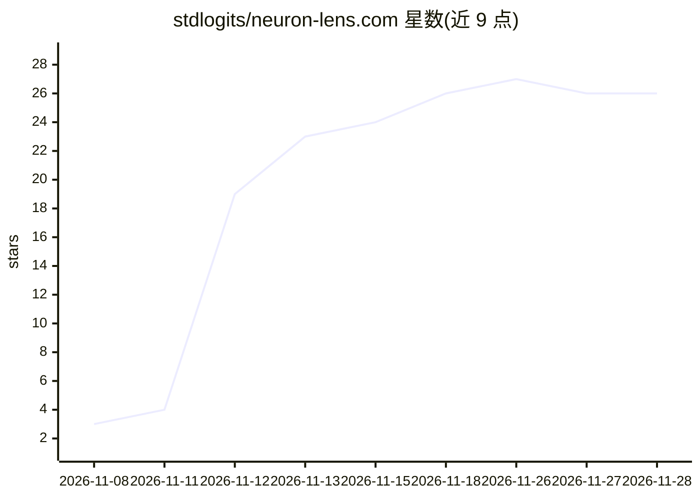

# stdlogits/neuron-lens.com

⭐ 26 · Svelte · AGPL-3.0 · 推送 2026-11-23 · [GitHub](https://github.com/stdlogits/neuron-lens.com) · [官网](https://neuron-lens.com) · 组织维护

**浏览 Qwen3-8B 与 Gemma 4 12B 各神经元/注意力头激活语义的网站**

面向机制可解释性研究的静态单页应用：展示 Qwen3-8B 与 Gemma 4 12B 中每个神经元与注意力头的激活词汇、最强激活示例、steering 推送效果，Gemma 4 还包含其响应的图像与声音，每个单元有 URL 地址可引用。数据来自预构建的 JSON 目录（数 GB，不在仓库内），标签由 Claude Haiku 5.5 生成。前端用 Vite+Svelte 5+TypeScript，无服务端代码，部署到 Cloudflare Pages。

## 筛选速览

| 维度 | 判定 | 备注 |
|---|---|---|
| AI 角色 | `ai-knowledge` | 知识聚合/清单类 |
| 许可风险 | `viral` | AGPL-3.0 |
| 部署形态 | `None` |  |
| 模型依赖 | — | README 未给出锁定关系 |
| 硬件要求 | — | 无带数字的原话,不猜 |
| 安装摩擦 | `low` | 无编译、无系统依赖或容器化 |
| 成熟度 | — | 结构信号不足 |

## 能力要点

- 按神经元/注意力头逐单元展示激活词、最强示例与 steering 推送结果
- Gemma 4 单元附带响应的图像与声音
- 每个单元有可引用的 URL 地址（如 /qwen3-8b/L8/n344）
- 静态 SPA，数据由脚本从 neuron-lens 目录构建并上传 Cloudflare R2

## 适用场景

- 查证某个神经元或注意力头对什么输入起反应
- 浏览 steering 实验中推动某单元会让模型说出什么
- 在论文或讨论中引用特定单元的地址链接

## 场景标签

`科研工具` · 领域:学习与行业

## 证据(README 行号)

> L3: neuron-lens.com shows what each neuron and attention head inside two open
> L28: The explorer reads a prebuilt catalog of static JSON (and, for Gemma 4, packs of images and sounds):

## 星数曲线

2026-11-08 3 → 2026-11-28 26（+23）

---
*卡片 v1 · prompt 1.4 · 生成 2026-11-18 · 置信度 high · 依据 README sha `bde019bb8ae1` · [字段定义](../../DATASET.md)*
