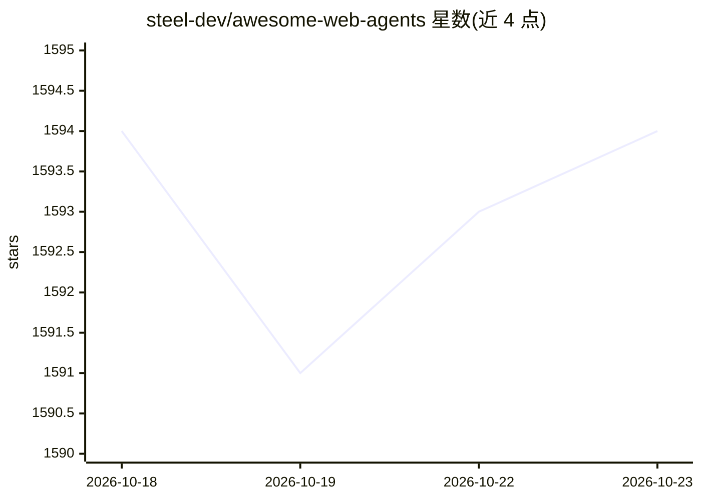

# steel-dev/awesome-web-agents

⭐ 1,594 · Python · NOASSERTION · 推送 2026-08-25 · [GitHub](https://github.com/steel-dev/awesome-web-agents) · 组织维护

**构建 AI 网页智能体的工具与框架策展清单**

由 Steel 维护的 awesome 清单，收录用于构建可浏览和操作网页的 AI 智能体的工具、框架与资源，按自主网页智能体（含 computer-use）、AI 网页自动化、开发者工具、AI 爬虫/抓取器、网页搜索与查询工具等类别组织，每条目附一句描述与 GitHub 星标。README 同时介绍维护方 Steel——一个面向 AI 智能体的开源浏览器 API，提供免费起步入口。清单本身无安装或运行方式。

## 筛选速览

| 维度 | 判定 | 备注 |
|---|---|---|
| AI 角色 | `ai-knowledge` | 知识聚合/清单类 |
| 许可风险 | `none` | NOASSERTION |
| 部署形态 | `None` |  |
| 模型依赖 | — | README 未给出锁定关系 |
| 硬件要求 | — | 无带数字的原话,不猜 |
| 安装摩擦 | `low` | 无编译、无系统依赖或容器化 |
| 成熟度 | — | 结构信号不足 |

## 能力要点

- 按自主智能体/自动化/开发工具/爬虫/搜索五大类组织条目
- 每个条目附一句事实性描述与 GitHub 星标
- 由 Steel（面向 AI 智能体的开源浏览器 API）团队维护并附带自家产品介绍

## 适用场景

- 为网页智能体项目选型时查找框架与工具
- 了解网页智能体、爬虫与搜索 API 的生态版图
- 对比 computer-use 与浏览器智能体的开源实现

## 场景标签

`精选清单` · 领域:学习与行业

## 证据(README 行号)

> L13: A curated list of tools, frameworks, and resources for building AI agents that can browse and interact with the web
> L29: ## Autonomous Web Agents
> L114: ## AI Web Scrapers/Crawlers

## 星数曲线

2026-10-18 1,594 → 2026-10-23 1,594（+0）

---
*卡片 v1 · prompt 1.4 · 生成 2026-10-21 · 置信度 high · 依据 README sha `085bf9818b8c` · [字段定义](../../DATASET.md)*
