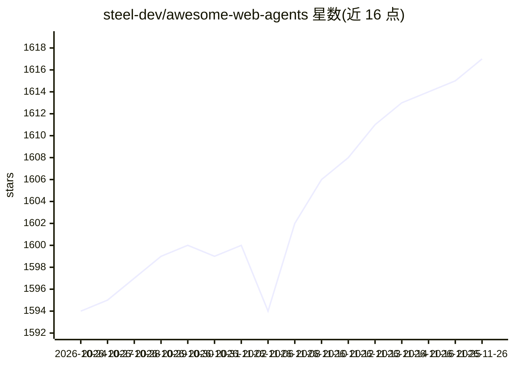

# steel-dev/awesome-web-agents

⭐ 1,617 · Python · NOASSERTION · 推送 2026-11-10 · [GitHub](https://github.com/steel-dev/awesome-web-agents) · 组织维护

**构建 AI 网页 Agent 的工具与资源清单**

由 Steel.dev 维护的 awesome 清单，收录用于构建可浏览并与网页交互的 AI Agent 的工具、框架与资源，按自主网页 Agent、Computer-use Agent、网页自动化工具（含 Dev Tools）、AI 网页爬虫等类别组织；条目为外部项目的一行式介绍并附 GitHub 链接，清单同时推介维护者自己的开源浏览器 API 产品 Steel。

## 筛选速览

| 维度 | 判定 | 备注 |
|---|---|---|
| AI 角色 | `ai-knowledge` | 知识聚合/清单类 |
| 许可风险 | `none` | NOASSERTION |
| 部署形态 | `None` |  |
| 模型依赖 | — | README 未给出锁定关系 |
| 硬件要求 | — | 无带数字的原话,不猜 |
| 安装摩擦 | `low` | 无编译、无系统依赖或容器化 |
| 成熟度 | — | 结构信号不足 |

## 能力要点

- 按自主网页 Agent、Computer-use、自动化工具、爬虫等类别组织条目
- 收录开源与商业项目，附 GitHub 仓库链接
- 覆盖浏览器扩展、headless 浏览器 API、agent 框架等多种形态

## 适用场景

- 为构建网页 Agent 选型浏览器自动化框架或基础设施
- 了解网页 Agent 生态中各项目的分布与形态
- 查找 AI 网页爬取/抓取工具

## 场景标签

`精选清单` · 领域:学习与行业

## 证据(README 行号)

> L13: A curated list of tools, frameworks, and resources for building AI agents that can browse and interact with the web
> L25:  Contents

## 星数曲线

2026-10-24 1,594 → 2026-11-26 1,617（+23）

---
*卡片 v1 · prompt 1.4 · 生成 2026-11-23 · 置信度 high · 依据 README sha `660586e66d80` · [字段定义](../../DATASET.md)*
