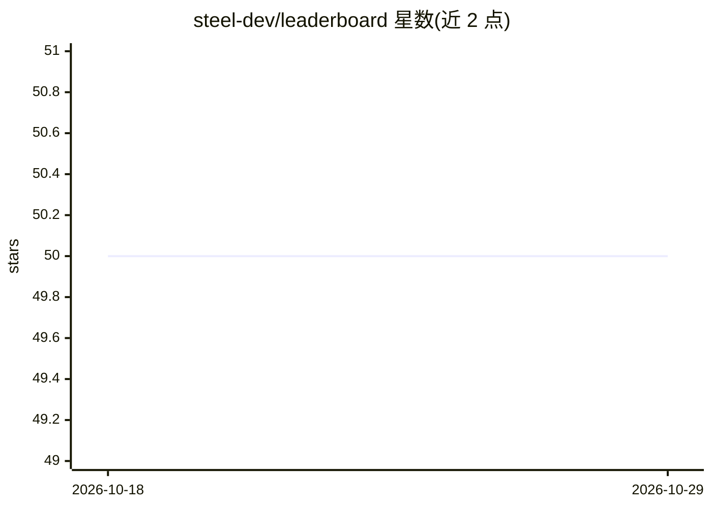

# steel-dev/leaderboard

⭐ 50 · TypeScript · MIT · 推送 2026-10-15 · [GitHub](https://github.com/steel-dev/leaderboard) · [官网](https://leaderboard.steel.dev) · 组织维护

**浏览器/计算机使用/编程 agent 公开基准排行榜参考**

由 Steel（开源浏览器 API 公司）维护的公开排行榜站点仓库，汇总 AI 浏览器 agent、computer-use 系统与编程 agent 在 WebVoyager、BrowseComp、WebArena、SWE-bench Verified、OSWorld、GAIA、τ-bench 等 17 个左右公开基准上的成绩，每个条目标注组织与来源链接。README 展示各基准前五名，并说明阅读规则：仅限同基准内比较、每个分数链接原始报告、区分 agent/model/mixed 范围。面向需要对比 agent 选型参考的开发者与研究者，MIT 许可。

## 筛选速览

| 维度 | 判定 | 备注 |
|---|---|---|
| AI 角色 | `ai-knowledge` | 知识聚合/清单类 |
| 许可风险 | `permissive` | MIT |
| 部署形态 | `None` |  |
| 模型依赖 | — | README 未给出锁定关系 |
| 硬件要求 | — | 无带数字的原话,不猜 |
| 安装摩擦 | `low` | 无编译、无系统依赖或容器化 |
| 成熟度 | — | 结构信号不足 |

## 能力要点

- 覆盖 WebVoyager、BrowseComp、OSWorld、SWE-bench Verified 等约 17 个公开基准的排名表
- 每个分数链接到原始报告（论文/博客/官方榜）
- 区分 agent 范围与 model 范围的条目组织方式

## 适用场景

- 选型前查各浏览器 agent / 编程 agent 在公开基准上的成绩
- 跟踪各家模型在 OSWorld、BrowseComp 等基准的最新排名
- 获取各成绩的原始报告出处

## 场景标签

`精选清单` `模型评测` · 领域:评测与运维

## 证据(README 行号)

> L1: # AI Browser Agent Leaderboards
> L3: Open reference for evaluating AI browser agents, computer-use systems, and coding agents across the public benchmark

## 星数曲线

2026-10-18 50 → 2026-10-29 50（+0）

---
*卡片 v1 · prompt 1.4 · 生成 2026-10-24 · 置信度 high · 依据 README sha `c27aa446e72e` · [字段定义](../../DATASET.md)*
