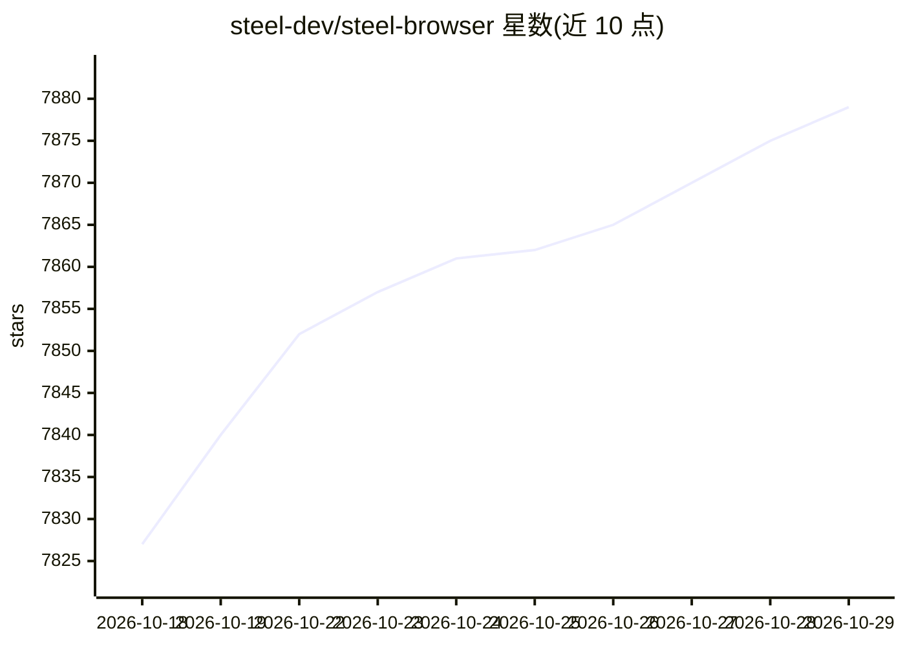

# steel-dev/steel-browser

⭐ 7,879 · TypeScript · Apache-2.0 · 推送 2026-10-28 · [GitHub](https://github.com/steel-dev/steel-browser) · [官网](https://steel.dev) · 组织维护

**面向 AI agent 的开源浏览器 API 与托管沙箱服务**

由 Steel 公司维护的开源浏览器 API：以 Docker 镜像或 Node.js 运行本地实例，底层用 Puppeteer 与 CDP 管理 Chrome 进程，提供会话管理（状态/cookie/本地存储跨请求保持）、代理链与 IP 轮换、Chrome 扩展加载、反检测指纹、请求日志调试 UI，以及 /scrape、/screenshot、/pdf 快捷端点。供 Puppeteer/Playwright/Selenium 客户端连接，并发放 Python 与 Node SDK；另有 Steel Cloud 托管服务，处于公开测试阶段。

## 筛选速览

| 维度 | 判定 | 备注 |
|---|---|---|
| AI 角色 | `ai-ecosystem` | LLM/agent 周边工具 |
| 许可风险 | `permissive` | Apache-2.0 |
| 部署形态 | `desktop` | 安装包/桌面程序 |
| 模型依赖 | — | README 未给出锁定关系 |
| 硬件要求 | — | 无带数字的原话,不猜 |
| 安装摩擦 | `low` | 无编译、无系统依赖或容器化 |
| 成熟度 | `idea` | |

## 能力要点

- 基于 Puppeteer/CDP 的会话管理，保持 cookie 与浏览器状态
- 内置代理链管理、反检测插件与指纹管理
- 提供 /scrape、/screenshot、/pdf 快捷 API 与调试 UI
- 提供 Python 与 Node SDK，兼容自托管与 Steel Cloud

## 适用场景

- 为 AI agent 提供可编程控制的浏览器环境
- 在自动化流程中抓取网页、截图或导出 PDF
- 复用现有 Selenium 工作流接入 Steel 浏览器会话

## 场景标签

`浏览器自动化` `网页抓取` · 领域:效率与自动化

## 证据(README 行号)

> L7:  The open-source browser API for AI agents & apps.
> L33: Steel.dev is an open-source browser API that makes it easy to build AI apps and agents that interact with the web. 

## 星数曲线

2026-10-18 7,827 → 2026-10-29 7,879（+52）

---
*卡片 v1 · prompt 1.4 · 生成 2026-10-20 · 置信度 high · 依据 README sha `f246e75cb88e` · [字段定义](../../DATASET.md)*
