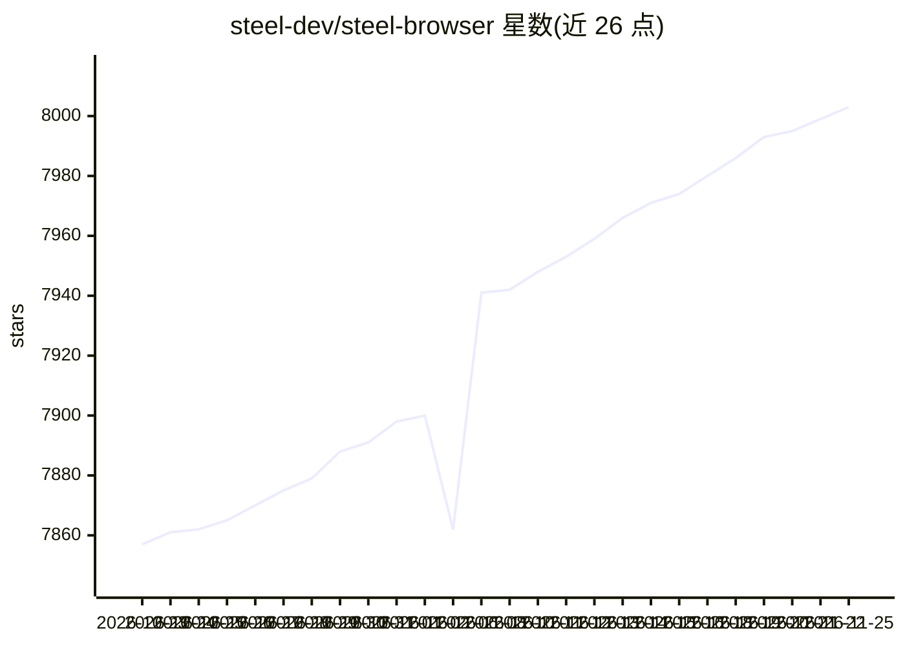

# steel-dev/steel-browser

⭐ 8,003 · TypeScript · Apache-2.0 · 推送 2026-11-23 · [GitHub](https://github.com/steel-dev/steel-browser) · [官网](https://steel.dev) · 组织维护

**面向 AI Agents 与应用的浏览器自动化 API 沙箱**

开源浏览器 API 服务，封装浏览器基础设施供开发者构建与运行网页自动化流程和 AI Agent：管理会话、页面与浏览器进程，维护 cookies 与本地存储，内置代理链、指纹管理、请求日志与会话回放 UI。通过 REST API 暴露 /sessions、/scrape、/screenshot、/pdf 等端点，可经 Puppeteer、Playwright、Selenium 或 Python/Node SDK 接入；Commands API 面向 AI Agent 提供页面快照与元素操作，默认关闭需环境变量开启。提供 Docker 镜像、docker compose 与 Node.js 三种运行方式，另设 Steel Cloud 托管服务。

## 筛选速览

| 维度 | 判定 | 备注 |
|---|---|---|
| AI 角色 | `ai-ecosystem` | LLM/agent 周边工具 |
| 许可风险 | `permissive` | Apache-2.0 |
| 部署形态 | `desktop` | 安装包/桌面程序 |
| 模型依赖 | — | README 未给出锁定关系 |
| 硬件要求 | — | 无带数字的原话,不猜 |
| 安装摩擦 | `low` | 无编译、无系统依赖或容器化 |
| 成熟度 | — | 结构信号不足 |

## 能力要点

- 会话管理：跨请求保持浏览器状态、cookies 与本地存储
- 兼容 Puppeteer、Playwright、Selenium 三种客户端接入
- 内置代理链、反检测插件与指纹管理
- 面向 AI Agent 的 Commands API：快照页面并按 ref 操作元素

## 适用场景

- 为 AI Agent 提供可托管的浏览器执行环境
- 批量抓取网页并转换为 markdown、截图或 PDF
- 需要代理轮换与会话保持的有状态爬取流程
- 接入已有 Selenium 工作流获得增强能力

## 场景标签

`浏览器自动化` `网页抓取` · 领域:效率与自动化

## 证据(README 行号)

> L33: Steel.dev is an open-source browser API that makes it easy to build AI apps and agents that interact with the web. 
> L35: Under the hood, it manages sessions, pages, and browser processes, allowing you to perform complex browsing tasks p
> L281: The `/sessions/{sessionId}/commands` endpoint drives the session's browser with high-level commands. It is built f

## 星数曲线

2026-10-23 7,857 → 2026-11-25 8,003（+146）

---
*卡片 v1 · prompt 1.4 · 生成 2026-11-23 · 置信度 high · 依据 README sha `92b1f8be19ee` · [字段定义](../../DATASET.md)*
