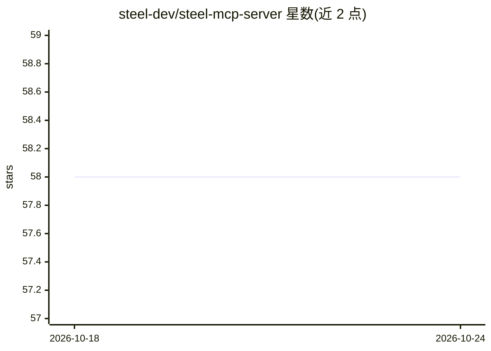

# steel-dev/steel-mcp-server

⭐ 58 · TypeScript · MIT · 推送 2026-10-20 · [GitHub](https://github.com/steel-dev/steel-mcp-server) · [官网](https://steel.dev) · 组织维护

**给 MCP 客户端提供云端 Chrome 浏览器操作的服务器**

Steel MCP Server 让 Claude、Cursor 等 MCP 客户端通过 16 个工具操作云端 Chrome：读取阻止普通 fetch 的页面、填表、截图、渲染 PDF，并在遇到登录或验证码时把浏览器移交给用户人工处理。机制上优先无会话抓取（steel_scrape），交互才开会话；以可访问性树而非像素定位元素；页面内容包在 untrusted-page-content 块中并去除提示注入载体。依赖 Steel API key，也可用 STEEL_LOCAL 配合自托管 steel-browser 镜像运行（无托管代理与验证码解决）。状态 3.0.0，未发布到 npm。

## 筛选速览

| 维度 | 判定 | 备注 |
|---|---|---|
| AI 角色 | `ai-ecosystem` | LLM/agent 周边工具 |
| 许可风险 | `permissive` | MIT |
| 部署形态 | `library` | 以包/库形式分发 |
| 模型依赖 | locked-api |  |
| 硬件要求 | — | 无带数字的原话,不猜 |
| 安装摩擦 | `low` | 无编译、无系统依赖或容器化 |
| 成熟度 | — | 结构信号不足 |

## 能力要点

- 16 个工具：抓取、截图、PDF、会话管理、表单填写等
- 登录墙/验证码自动触发 steel_session_handoff 移交人工
- 页面内容以 untrusted-page-content 包裹并剥离提示注入载体，凭据脱敏
- 支持 STEEL_LOCAL 自托管 steel-browser，无需 API key

## 适用场景

- 让 AI 客户端读取反爬或需 JS 渲染的页面
- 让 agent 代填表单，敏感步骤人工接管
- 对页面截图或转 PDF 供人查看
- 团队通过 Streamable HTTP 共享同一 MCP 端点

## 场景标签

`浏览器自动化` `网页抓取` · 领域:效率与自动化

## 证据(README 行号)

> L8: Give Claude, Cursor, or any MCP client a real Chrome in the cloud. Read pages that block a plain
> L30: claude mcp add steel -e STEEL_API_KEY=your-steel-api-key -- npx -y github:steel-dev/steel-mcp-server

## 星数曲线

2026-10-18 58 → 2026-10-24 58（+0）

---
*卡片 v1 · prompt 1.4 · 生成 2026-10-24 · 置信度 high · 依据 README sha `8a0ee9dd79b7` · [字段定义](../../DATASET.md)*
