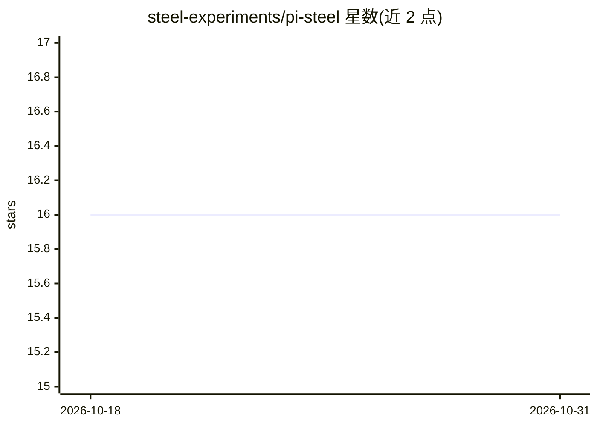

# steel-experiments/pi-steel

⭐ 16 · TypeScript · MIT · 推送 2026-07-29 · [GitHub](https://github.com/steel-experiments/pi-steel) · [官网](https://steel.dev/) · 组织维护

**Pi 编程代理的 Steel 云浏览器工具扩展**

Steel 官方发布的 Pi coding agent 扩展包（npm:@steel-dev/pi），通过 Steel CLI 登录或 API key 认证接入 Steel 云浏览器，向 Pi 暴露导航、检查、交互、截图/PDF、结构化数据抽取、低层输入与会话生命周期等工具。会话支持 session/agent/turn 三种释放模式，快照返回 ARIA 树支持按角色/名称定位控件。支持代理与 CAPTCHA 环境变量配置，可指向自托管 API。需 Node.js 22.19+ 与支持包扩展的 Pi 运行时。

## 筛选速览

| 维度 | 判定 | 备注 |
|---|---|---|
| AI 角色 | `ai-ecosystem` | LLM/agent 周边工具 |
| 许可风险 | `permissive` | MIT |
| 部署形态 | `library` | 以包/库形式分发 |
| 模型依赖 | — | README 未给出锁定关系 |
| 硬件要求 | — | 无带数字的原话,不猜 |
| 安装摩擦 | `low` | 无编译、无系统依赖或容器化 |
| 成熟度 | — | 结构信号不足 |

## 能力要点

- 提供导航/交互/截图/PDF/结构化抽取等一整套浏览器工具
- steel_snapshot 返回 ARIA 树，按角色/名称定位控件
- session/agent/turn 三种会话模式与代理、CAPTCHA 配置
- 支持自托管 API（STEEL_BASE_URL 指向）

## 适用场景

- 让 Pi 代理浏览网页并完成点击、填表等操作
- 抓取页面内容或生成截图/PDF
- 在需要代理或验证码处理的站点执行自动化工作流

## 场景标签

`浏览器自动化` · 领域:效率与自动化

## 证据(README 行号)

> L6: Official Steel cloud-browser tools for the Pi coding agent.
> L46: ## Browser tools
> L160: This package graduates the original `@steel-experiments/pi-steel` prototype into the official `@steel-dev` scope. 

## 星数曲线

2026-10-18 16 → 2026-10-31 16（+0）

---
*卡片 v1 · prompt 1.4 · 生成 2026-10-30 · 置信度 mid · 依据 README sha `b9843ac4c446` · [字段定义](../../DATASET.md)*
