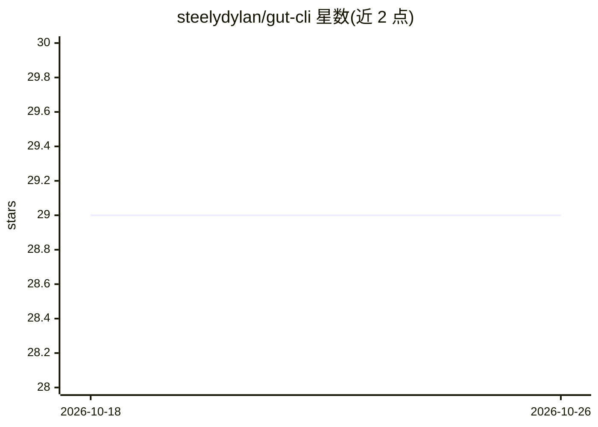

# steelydylan/gut-cli

⭐ 29 · TypeScript · MIT · 推送 2026-06-04 · [GitHub](https://github.com/steelydylan/gut-cli) · [官网](https://jsers.dev/service/gut-cli) · 个人维护

**AI 驱动的 git 命令行工具：生成提交信息/PR 描述等**

面向开发者的 npm 全局安装 CLI（gut），将 AI 用于 git 操作中的文本生成任务：提交信息、PR 描述、代码审查、合并冲突解决、变更解释、按模糊描述查找提交、生成分支名/stash 命名/变更日志/.gitignore、每日/每周工作总结。支持 Gemini（默认）、OpenAI、Anthropic 及 Ollama（本地），可配置自定义 base URL 接入 OpenAI 兼容 API（如 Groq）。API key 存储于操作系统原生凭据管理器，各命令支持 .gut/ 模板自定义。限制：需自带 API key，无订阅。

## 筛选速览

| 维度 | 判定 | 备注 |
|---|---|---|
| AI 角色 | `ai-native` | 本体是模型或模型工具 |
| 许可风险 | `permissive` | MIT |
| 部署形态 | `library` | 以包/库形式分发 |
| 模型依赖 | local-ok | 支持本地模型 |
| 硬件要求 | — | 无带数字的原话,不猜 |
| 安装摩擦 | `low` | 无编译、无系统依赖或容器化 |
| 成熟度 | — | 结构信号不足 |

## 能力要点

- 16 个 git 相关命令覆盖提交/PR/审查/合并/解释/查找等场景
- API key 存入系统原生凭据存储（macOS Keychain/Windows Credential Vault/Linux libsecret）
- 项目级/全局/内置三级模板自定义，支持非英语输出
- 可配置自定义 base URL 接入 Ollama 本地实例或 OpenAI 兼容 API

## 适用场景

- 生成符合规范的提交信息与 PR 描述
- AI 辅助解决合并冲突与代码审查
- 按模糊描述查找历史提交
- 自动生成日报/周报与变更日志

## 场景标签

 · 领域:开发者工具/git

## 证据(README 行号)

> L3: **Git Utility Tool** - AI-powered git commands for smarter workflows.
> L38: |`gut commit`|Generate commit messages|
> L40: |`gut review`|Code review|

## 星数曲线

2026-10-18 29 → 2026-10-26 29（+0）

---
*卡片 v1 · prompt 1.4 · 生成 2026-10-26 · 置信度 high · 依据 README sha `74b8bcf37640` · [字段定义](../../DATASET.md)*
