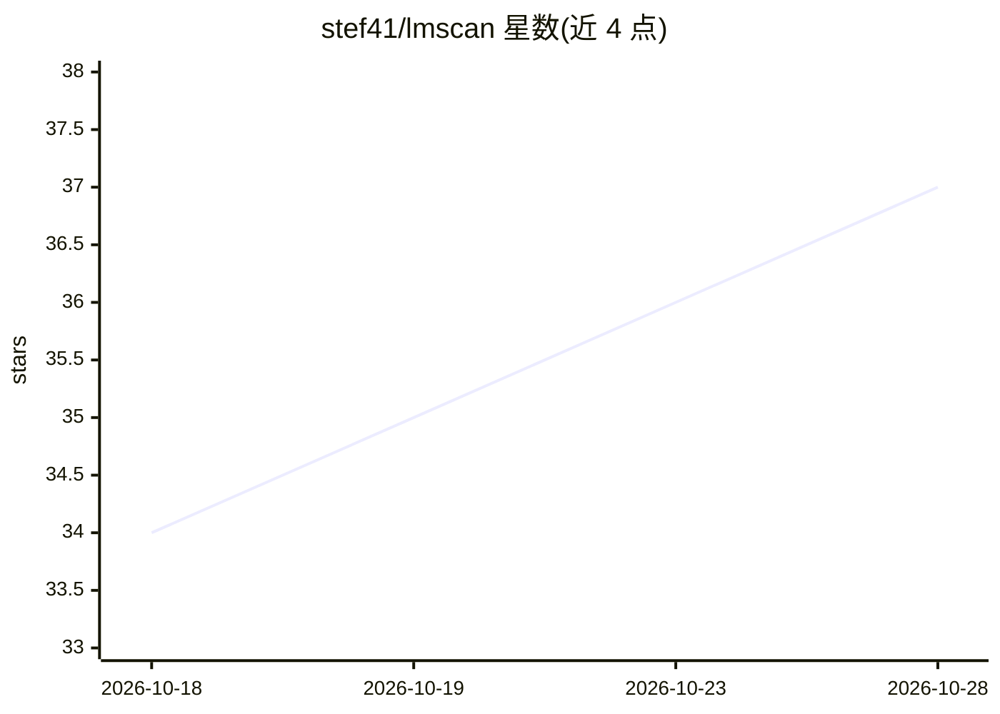

# stef41/lmscan

⭐ 37 · Python · NOASSERTION · 推送 2026-04-11 · [GitHub](https://github.com/stef41/lmscan) · 个人维护

**离线检测 AI 生成文本并识别来源模型家族的 Python 工具**

基于 12 个计算语言学统计特征（突发性、词汇丰富度、Zipf 偏差、AI 词汇密度等）计算文本的 AI 概率，并通过 5 个 LLM 家族（GPT-4/Claude/Gemini/Llama/Mistral）的词汇指纹判定文本来源模型。零依赖、无需 API key、无网络请求，可在 CI、pre-commit 中批量扫描。自述限制：仅支持英语、短文本（<50 词）不可靠、无法检测人工改写过的 AI 文本，属统计启发式而非神经分类器。

## 筛选速览

| 维度 | 判定 | 备注 |
|---|---|---|
| AI 角色 | `ai-native` | 本体是模型或模型工具 |
| 许可风险 | `none` | NOASSERTION |
| 部署形态 | `library` | 以包/库形式分发 |
| 模型依赖 | — | README 未给出锁定关系 |
| 硬件要求 | — | 无带数字的原话,不猜 |
| 安装摩擦 | `low` | 无编译、无系统依赖或容器化 |
| 成熟度 | — | 结构信号不足 |

## 能力要点

- 12 个统计特征加权合成 AI 概率，输出可解释证据
- 5 个 LLM 家族的词汇指纹归因
- 零依赖、离线运行、无需 GPU 与 API key
- 提供 CLI、Python API、目录批量扫描与 GitHub Actions/pre-commit 集成

## 适用场景

- 我想免费离线检测一段文本是否由 AI 生成
- 我想知道某段文本可能出自哪个 LLM 家族
- 在 CI 或 pre-commit 中对提交文本做 AI 内容检查

## 场景标签

 · 领域:NLP/AI 文本检测

## 证据(README 行号)

> L65: lmscan uses **12 statistical features** derived from computational linguistics research to distinguish AI-generated
> L84: lmscan includes vocabulary fingerprints for 5 major LLM families:

## 星数曲线

2026-10-18 34 → 2026-10-28 37（+3）

---
*卡片 v1 · prompt 1.4 · 生成 2026-10-25 · 置信度 high · 依据 README sha `76173f431001` · [字段定义](../../DATASET.md)*
