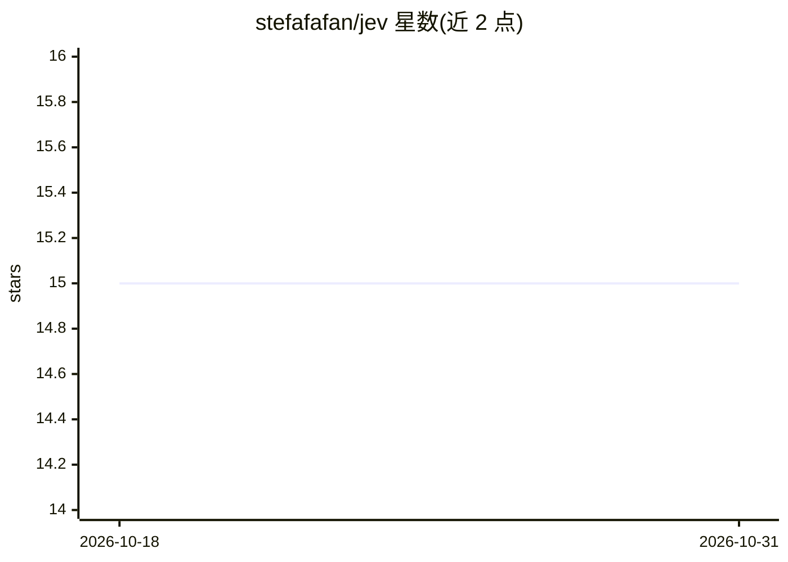

# stefafafan/jev

⭐ 15 · Go · MIT · 推送 2026-10-27 · [GitHub](https://github.com/stefafafan/jev) · [官网](https://github.com/stefafafan/jev) · 个人维护

**Jev 评估模型的非官方多提供商 Unix 命令行客户端**

用 Go 编写的命令行工具，通过 stdin 读取状态并以三种原语子命令（noul 二值判断、choice 多选项分类、score 有序分级）向 Jev 模型发起单问评估，默认输出 JSON 并以退出码报告成功与否，不将判断转为策略，阈值判断交由下游处理。支持 TypeSafe AI、Cloudflare Workers AI、Vercel AI Gateway 三种提供商，通过环境变量设置凭据。提供 go install、源码构建及 GitHub Actions 安装方式。

## 筛选速览

| 维度 | 判定 | 备注 |
|---|---|---|
| AI 角色 | `ai-ecosystem` | LLM/agent 周边工具 |
| 许可风险 | `permissive` | MIT |
| 部署形态 | `library` | 以包/库形式分发 |
| 模型依赖 | — | README 未给出锁定关系 |
| 硬件要求 | — | 无带数字的原话,不猜 |
| 安装摩擦 | `low` | 无编译、无系统依赖或容器化 |
| 成熟度 | — | 结构信号不足 |

## 能力要点

- noul/choice/score 三种评估原语子命令
- 支持 TypeSafe AI、Cloudflare、Vercel 三种提供商
- 默认 JSON 输出，退出码报告结果，阈值判断留给下游管道
- stdout 仅含成功结果，诊断信息写入 stderr

## 适用场景

- 在 CI 中对 PR diff 做合并风险分级并打标签
- 用管道对任意文本状态做单问评估（如事件是否需立即处理）
- 以 jq 等工具在下游按阈值自动决策

## 场景标签

`模型网关` · 领域:Agent 开发

## 证据(README 行号)

> L3: An unofficial, provider-neutral Unix client for Jev from TypeSafe AI. Written in Go.
> L109: The CLI supports TypeSafe AI, Cloudflare Workers AI, and Vercel AI Gateway.

## 星数曲线

2026-10-18 15 → 2026-10-31 15（+0）

---
*卡片 v1 · prompt 1.4 · 生成 2026-10-30 · 置信度 high · 依据 README sha `e209b45b981d` · [字段定义](../../DATASET.md)*
