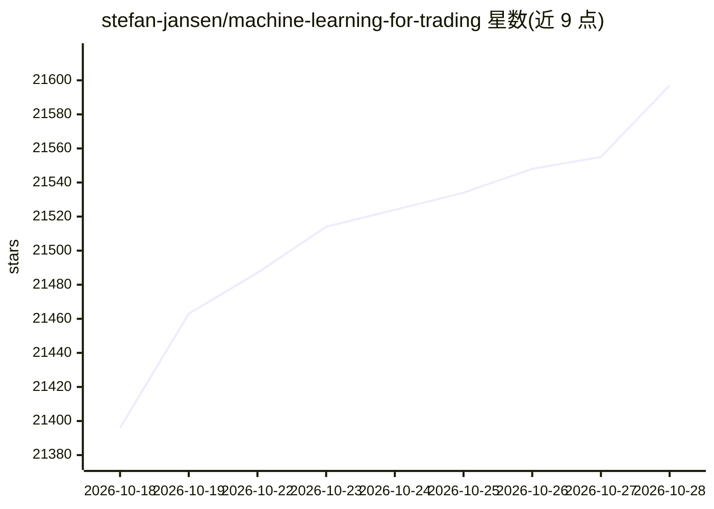

# stefan-jansen/machine-learning-for-trading

⭐ 21,597 · Jupyter Notebook · MIT · 推送 2026-10-23 · [GitHub](https://github.com/stefan-jansen/machine-learning-for-trading) · [官网](https://ml4trading.io) · 个人维护

**为交易研究者提供机器学习交易策略的图书配套代码库**

Stefan Jansen《Machine Learning for Trading》第三版的全书代码：27 章、9 个案例研究，围绕一条从数据基础设施、策略研究到部署监控的端到端工作流组织。覆盖梯度提升、深度时间序列、因果机器学习、强化学习、生成式 AI（基于 SEC 文件的 RAG、Graph RAG、多智能体研究系统）与合成金融数据生成。数据层使用 Polars，每章提供可复现的 Docker 环境。

## 筛选速览

| 维度 | 判定 | 备注 |
|---|---|---|
| AI 角色 | `ai-knowledge` | 知识聚合/清单类 |
| 许可风险 | `permissive` | MIT |
| 部署形态 | `self-host` | docker 或自建部署 |
| 模型依赖 | — | README 未给出锁定关系 |
| 硬件要求 | — | 无带数字的原话,不猜 |
| 安装摩擦 | `low` | 无编译、无系统依赖或容器化 |
| 成熟度 | — | 结构信号不足 |

## 动量与使用信号

- 维护:`active` — 距上次 push 2.2 天,年发版 5,17 位贡献者
- 涨星:近 1 天 **+28**(自 20261016 起算)

## 能力要点

- 27 章与 9 个横贯全书的案例研究（ETF、加密永续、日内股票、期权、外汇、期货等）
- 模型工具箱含 XGBoost/LightGBM/CatBoost 与 PatchTST、iTransformer、Mamba 等时间序列架构
- 生成式 AI 章节：SEC 文件 RAG、知识图谱与 Graph RAG、多智能体研究系统
- 每章提供可复现 Docker 环境，数据层基于 Polars

## 适用场景

- 按书中章节复现机器学习交易策略的回测流程
- 学习从数据管道到实盘部署的量化研究工作流
- 参考合成金融数据与因果推断在交易研究中的实现

## 场景标签

`金融量化` `教程课程` · 领域:学习与行业

## 证据(README 行号)

> L5: The code for *Machine Learning for Trading, 3rd Edition* by
> L37: - **Generative AI**: retrieval-augmented generation grounded in SEC filings, knowledge graphs and Graph RAG, and
> L51: The data layer moves to **Polars** for fast, expression-based manipulation, and every chapter ships in **reproducib

## 星数曲线

2026-10-18 21,396 → 2026-10-28 21,597（+201）

---
*卡片 v1 · prompt 1.4 · 生成 2026-10-18 · 置信度 high · 依据 README sha `8f8928460ea6` · [字段定义](../../DATASET.md)*
